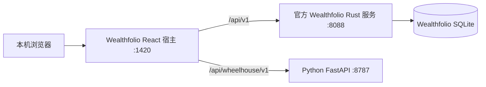

# Wealthfolio + Python 架构底座

日期：2026-09-26。范围：用户确认的 A0 架构定稿、A1 工程骨架及最小宿主连通验证。后续数据/计算框架与策略功能不算本阶段已完成。

## 运行结构

浏览器只访问同源路径，Vite 开发代理分流请求。Wealthfolio 使用固定版本的官方 Docker 服务；Python 在独立虚拟环境中运行。全部对宿主机开放的端口绑定 `127.0.0.1`，数据保留在 `.local/wealthfolio-data`。此配置面向可信单用户本机开发，无内置网页登录验证，不能照搬为远程部署；正式环境需统一入口认证与代理。

Docker 使用已有 bridge 网络，避免依赖本机可用的新网络地址池。容器内部按官方 Web 开发配置监听所有接口，对宿主仅映射 loopback；MCP 关闭。密钥由 setup 本地生成并以 0600 权限保存，不能提交。

## 模块职责与依赖

- **宿主：** Wealthfolio 的导航、账户、组合、设置和本地存储。Market intelligence 是同一导航中的原生路由，页面复用宿主 Page/Button 等 UI。首期保持宿主样式；完整 Wheelhouse 视觉改造另行覆盖共享 shell。
- **调用客户端：** 将 HTTP/超时/不兼容契约转换为明确错误，响应必须经过运行时校验；前台每 10 秒检查一次，单次请求 5 秒超时；失联后最迟约 15 秒撤下连接成功状态，切回页面也立即复验。
- **Python HTTP Adapter：** 版本化响应、请求 ID、统一错误和最少量日志。只记录路由名、状态和耗时，不记录查询参数、金融值或异常消息。
- **契约：** Pydantic 是 HTTP 结构来源，OpenAPI 生成 TypeScript 类型。契约版本与软件版本分开，前端拒绝不支持的契约版本。
- **后续计算模块：** 作为 Python 内部模块接入，保持与 FastAPI、Wealthfolio 和数据库独立；已有业务实验代码需在 A2/A3 验收时逐项迁入。

Python 首期只提供状态查询。`ready` 表示进程和接口可用，不代表行情、券商或策略引擎已接入。任何交易接口都不在此服务范围内。Wealthfolio 自身可进行账本录入，属于本地记账，不是券商交易执行。

## 可复现的源码管理

- `integrations/wealthfolio/upstream.json` 固定官方 tag、commit、Docker digest 和 pnpm 版本。
- `.local/wealthfolio` 是忽略提交的上游 checkout。
- `integrations/wealthfolio/patches` 保存已有源码的最小补丁。
- `integrations/wealthfolio/overlay` 保存我们新增的宿主文件。
- `make sync` 验证上游 commit、完整 tracked diff 与声明补丁一致性，以及 overlay 内容指纹；遇到未知的受跟踪文件或受管 overlay 修改就停止，避免覆盖。
- 构建关闭自动清空输出目录；旧产物会保留，不能直接把累积的目录当作正式发布包。

## 阶段与验收

| 阶段 | 验收重点 | 本轮范围 |
|---|---|---|
| A0 架构定稿 | 宿主、数据所有权、Python 调用方式、部署形态明确 | 包含 |
| A1 工程骨架 | 固定依赖、setup/dev/check/build、日志、错误、CI | 包含 |
| A2 数据底座 | 来源、时区、修订、幂等、行情存储及迁移 | 后续 |
| A3 计算框架 | 同一引擎服务实时与回放、规则版本、任务恢复 | 后续 |
| A4 应用接口 | 完整分析契约、图表与状态交互 | 本轮仅验证状态接口与宿主路由 |
| A5 集成验收 | 数据链路、断网恢复、重启和性能 | 本轮仅验证宿主/Python 连接、断开和恢复 |

验收接口为 Python HTTP、宿主调用客户端，以及实际 Wealthfolio 页面。数据与金融算法测试不在本轮扩大范围；不把实验指标计入底座完成度。

## 来源核验

已于 2026-09-26 读取官方 v3.8.0：

- [发布版](https://github.com/wealthfolio/wealthfolio/releases/tag/v3.8.0)
- [网络 broker 实现](https://github.com/wealthfolio/wealthfolio/blob/v3.8.0/crates/core/src/addons/network.rs)
- [宿主路由](https://github.com/wealthfolio/wealthfolio/blob/v3.8.0/apps/frontend/src/routes.tsx)
- [Web 服务说明](https://github.com/wealthfolio/wealthfolio/blob/v3.8.0/apps/server/README.md)
- [addon SDK](https://github.com/wealthfolio/wealthfolio/blob/v3.8.0/packages/addon-sdk/src/host-api.ts)

早期 `backend/`、`frontend/` 和 `docs/implementation/market-engine.md` 为独立技术实验，不由 `make dev` 启动，也不代表经过确认的生产算法。原型继续从 `prototypes/` 独立运行。真实 moomoo SG 接入、Tauri 桌面打包、账户权限和策略正确性均未在本阶段验证。

## 本轮验证记录

2026-09-26 本机验证：固定版源码安装和补丁同步完成；Python lint、严格类型检查、3 个 HTTP 测试通过；Wealthfolio 全宿主 TypeScript 检查及 3 个连接契约测试通过；修改后的 Web 宿主构建通过。构建保留上游 sourcemap 和较大 chunk 提示，不代表桌面包已验证。

实际浏览器已从 Wealthfolio 同一导航进入 Market intelligence，读取 Python 版本及契约版本；390px 页面无横向溢出。暂停 Python 进程后页面超时并撤下连接成功状态；恢复后可重新检查连接。独立开发数据库保持无账户、无交易记录。CI 工作流已配置，本地运行了对应检查，尚未在远端执行。
