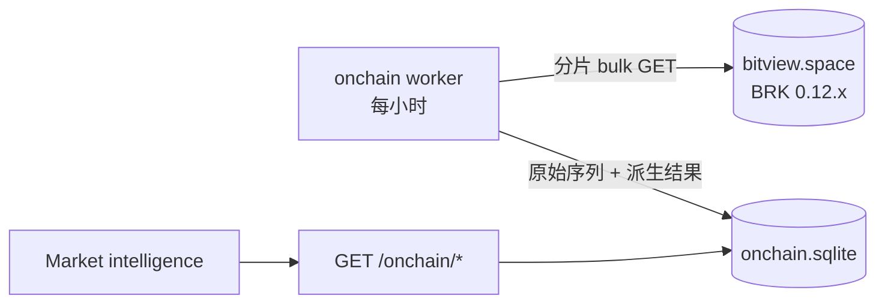

# BTC 链上与永续指标融合 Spec

日期：2026-10-16。状态：**草案 v3，待用户审阅**。界面已经用可视化伴侣逐屏确认；修订记录见 §10。审阅通过后，按阶段写实施计划（PLAN.md），然后开始实现。

**依据**
- [数据源核验](../../../research/alpha-dashboards-data-sources-2026-10-16.md)
- [计算逻辑与用法](../../../research/alpha-dashboards-logic-2026-10-16.md)
- [周期六态 classifier v2](../../../research/alphabtc-regime-cycle-source-2026-09-28.md)
- 本地证据：`.local/research-samples/alpha-dashboards-2026-10-16/`，已 gitignore。包括页面源码、逐页笔记、BRK 数据、复算脚本和 `/api/perps` 样本。
- 界面定稿 mockup：`.superpowers/brainstorm/33535-1792151482/content/`，共四屏：`layout-overview`、`key-levels`、`flows`、`mobile`。

**做法**
- 用户是原看板的作者，包括 alphabtc state-report，以及 alpha-vol 的 perp-squeeze、onchain-seller、onchain-pulse。
- 按用户要求分两步：
  1. **v1 先完全照原站口径重新实现**，界面也照原站做法。v1 不复制源码，但计算结果要与原站逐数对上。
  2. **v1 验收后，再按 §4 的优化清单逐项改进。**

## 0. 决定汇总

| # | 决定 | 结论 | 来源 |
|---|---|---|---|
| D1 | 页面结构 | 4 个方法 tab：TD Sequential / Key levels / Fibonacci / **Flows**；页头加周期徽章 | 第 1 屏选 A |
| D2 | 密集带画法 | 画在价格图右侧的刻度轨，成本线横贯整张图 | 第 2 屏选 B |
| D3 | Flows 布局 | 照原站多图纵排；"一张大图 + 详情"的约定只在 Flows tab 放宽 | 第 3 屏选 A |
| D4 | 窄屏说明文字 | 手机上也照原站，全部展开 | 第 4 屏选 B |
| D5 | 计算口径 | v1 = 原站口径；改进放进 §4 优化清单 | 用户："先按他那边来，做好后再自我优化" |
| D6 | 周期分类器 | 用 alpha-vol 页头版：整体门控，死区 7.0 / 6.8 / 1.25，从 2013 起算。这是本次融合的几页实际使用的版本。如果你要用 classifier v2，再告诉我 | 按 D5 推定 |
| D7 | 永续数据源 | 待你回复，见 §3.4 | — |

批准后同步更新 AGENTS.md 的「已确认的 UI」：加入 Flows tab，并写明 Flows 内允许多图纵排。

## 1. 目标与范围

**目标**：在 Market intelligence 里，对 BTCUSDT 提供四项能力：
- 周期状态；
- 链上成本价位；
- 链上卖压；
- 永续状态（P4，另立 spec）。

**成功标准**

| # | 标准 |
|---|---|
| 1 | v1 在同一份数据上，与原站页面数值一致：周期状态、成本线、密集带和价位表、卖压三张图的当前值与阈值。容差见 §6 |
| 2 | 只要读数里含未收盘的 bar 或日，界面就明确标出 forming。缺失和 QC 问题必须显示出来，不能当 0 静默处理（[金融领域规则](../../financial-domain.md)） |
| 3 | §4 的每一项优化都单独实现、单独测试、单独开启，开启前后的差异写进验收记录 |
| 4 | 在 1440px 和 390px 宽度下浏览器核验：无横向溢出，键盘能切换 tab，控制台无报错 |

**不做**
- onchain-pulse 的 Exp1–6，以及人工解读。备注：onchain-pulse Chart 5（Plotly/log200 改写版）是否复用图 8，留给 Supplementary 计划决定。
- ETH 和 MU 的链上指标，因为 BRK 只覆盖比特币。
- 任何交易能力，以及链上 as-known 回放（理由见 §7）。

## 2. 架构

沿用 portfolio 子系统的模式：独立子包、独立 SQLite、独立 worker。
- worker 遵守 `create_app` 的 `start_worker` 参数。
- worker 负责取数，并预先算好派生结果。
- 读接口只读本地库，**处理请求时不访问 BRK，也不现算 KDE、GMM 或分位数**。
- 这条规则对图 3、图 4 同样成立，并且不变：图 3、图 4 的 KDE/峰/GMM/BIC 在浏览器计算（用户 2026-10-19 选方案 C），worker 只存输入，读接口原样返回。详见 §3.5。
- 图 8 的 Contrast 分位、Range 和缩放在前端按屏幕上可见的格子计算，服务端只按 Span 切片。详见 §3.7。
- 服务对响应启用 gzip（`GZipMiddleware`，R20），所有 ≥ 1 KiB 的响应都压缩，不只是 onchain。

**后端**（`services/analytics/src/wheelhouse_service/onchain/`）

| 文件 | 职责 |
|---|---|
| `brk.py` | 按权重分片的 bulk 请求、逐条重试、URPD、`/version` |
| `store.py` + `migrations/` | 存储 |
| `sync.py` | worker |
| `cycle.py`、`pressure.py`、`levels.py` | 纯计算 |
| `costflow.py` | 图 3、图 4 的 worker 侧输入（纯函数）：网格列、年龄组、AGEFLOOR、QC、缺失与不一致的原因；不含 KDE、峰检测和 GMM |
| `costbasis_history.py` | 图 8 的 worker 侧输入（纯函数）：压缩行 `history_row`、1,461 天窗口与各天状态；不含分位、Range 和缩放 |
| `models.py` | 契约 |
| `api.py` | 路由 |

**前端**（`overlay/.../wheelhouse/`）
- 新增：`onchain-client.ts`（Zod 校验）、`cycle-badge.tsx`、`onchain-levels.tsx`、`levels-rail.tsx`、`flows-panel.tsx`、`seller-charts.tsx`、`flow-read.tsx`（三栏说明）。
- 修改：`market-page.tsx`、`market-chart.tsx`、`i18n.ts`、`market.css`。
- 契约生成：Pydantic → OpenAPI → `make contract`。

## 3. 计算规则（v1 = 原站口径）

### 3.0 BRK 数据层（M0，基础设施，v1 和优化共用）

**要取的序列**

| 索引 | 序列 | 范围 |
|---|---|---|
| day1 | `price_close`、`true_market_mean`、`sth_realized_price`、`lth_realized_price`、`realized_price`、`utxos_1d_to_1w_old_realized_price` | 从 2013-01-01 起 |
| hour1 | `price_close`、`{sth,lth}_realized_{profit,loss}_cumulative`、`utxos_under_1h_old_realized_{profit,loss}_cumulative`、`sth_supply_in_{loss,profit}`、`utxos_under_1h_old_supply_in_{loss,profit}`，共 11 条；不取 `timestamp`，时间由位置推出（P2 实施时修订，见 PLAN-P2 裁定 P2-R1、P2-R6） | 最近 3,000 小时。v1 用其中最近 2,600 小时，与原站相同 |
| URPD | `all`、`sth`、`lth`，当天快照，`agg=lin500`；用户切换 Bucket 时再取 `lin200` 或 `lin1000` | 每小时刷新当天快照 |

**请求约束**（2026-10-16 实测）
- **单次权重上限 320,000**，约每点 16，所以一次最多约 2 万点。按每片不超过 18,000 点分片：day1 分 2 片，hour1 首次回填分 2 片（P2 实施时修订，见 PLAN-P2 裁定 P2-R1、P2-R6），增量刷新只取最后几个点。
- **bulk 是全有或全无**：只要有一个序列名不存在，整批都返回 `series_not_found`。这时把该片拆成逐条请求，找出缺失的序列，记为 `series_missing:<name>`。只有依赖这个序列的模块显示 unavailable。

**调度**：每小时 HH:12 UTC 刷新，刷新完重算全部派生结果。

**存储**

| 表 | 字段 |
|---|---|
| `series` | series, index, position, ts, value（可为 NULL）, fetched_at |
| `urpd` | cohort, date, agg, close, total_supply, buckets_json, fetched_at |
| `urpd_history` | day, close, supplies_json, fetched_at（迁移 `002_urpd_history.sql`）。只存 `all lin500` 已定稿的日快照，覆盖最近 1,461 天，不受 P3-R14 的清理影响；见 §3.7 |
| `derived` | kind, as_of, payload_json, computed_at |
| `sync_state` | BRK 版本、各序列 `version`、最近成功时间、最近错误码 |

**版本变化**：先把新数据取到临时表，校验通过后原子替换。替换完成前继续用旧数据，`refreshing` 为真。

**新鲜度**：以最后一行的时间计算。hour1 在 2 小时内为 fresh，6 小时内为 delayed，超过 6 小时为 stale，从未取到为 unavailable。day1 的最后一行如果不是今天，就是 stale。

**失败处理**：保留旧数据，状态随时间自然降级，记录错误码，不补 0。日志只记路由、错误码和耗时。

**forming 标记**：BRK 不标注是否收盘，最后一行就是盘中值。v1 照原站使用这一行，但所有响应都要带上 `forming_at`（最后一行的时间），界面写明"includes the forming hour/day"。

### 3.1 周期六态（M1）

规则照 alpha-vol 页头。

**输入**：从 2013-01-01 起的 day1 序列 W（`utxos_1d_to_1w_old_realized_price`）、STH、TMM，**包含当天未收盘的值**。三条中任一条缺值的日期，整行删除。

**三个量**
- depth = 100·ln(W/TMM)
- spread = 100·ln(STH/TMM)
- pvs = depth − spread

**状态映射**：值大于 0 记为正，其余记为负。三个符号对应六种状态：

| 状态 | 成本线排序 |
|---|---|
| Advance | W > STH > TMM |
| Breakout | W > TMM > STH |
| Pressure | STH > W > TMM |
| Repair | TMM > W > STH |
| Breakdown | STH > TMM > W |
| Capitulation | TMM > STH > W |

**滞回（整体门控）**
- 第一行直接取原始状态。
- 此后，若原始状态与当前状态不同，只有当每个发生翻转的分量都满足 |值| > 死区时才切换；否则不动，也不记住部分翻转。
- 死区：depth 7.0、pvs 6.8、spread 1.25。

**天数**：本段的行数，含今天。

**QC**：最后一行距今超过 3 天时，提示数据过期。

**输出**
- 当前状态、开始日期、第 N 天；
- 三个量、死区、是否支持当前状态；
- 全部历史段，以及切换总次数。

### 3.2 成本价位（M2，照 state-report 图 7 和表 2）

**模型线**：5 条，取 day1 最后一行（含当天）。

| 名称 | 来源 |
|---|---|
| True mean | `true_market_mean` |
| Short-term | `sth_realized_price` |
| Average | `realized_price` |
| Long-term | `lth_realized_price` |
| Median | 由 `all` lin500 URPD 计算：累计供应达到总供应一半的位置，在桶内线性插值；包含低于 $1,000 的币 |

**密集带（K）**
- STH、LTH 分开计算，输入为当天 lin500 URPD。
- 价格域：floor ≥ $1,000 的全部桶，相当于原站 RANGE=All 的默认视图。
- 算法：
  1. 以供应量为权重做高斯 KDE，带宽 = 0.02 × 价格域跨度。
  2. 取局部极大，保留 prominence ≥ 0.05 × 最高峰的峰，峰数不设上限。
  3. 每个峰输出：center；WIDTH = 半高全宽（FWHM）；BTC = center ± FWHM/2 内的权重和；SHARE = BTC ÷ 该侧总权重；STRENGTH = prominence ÷ 最高峰。

**高斯成分（M）**
- 用加权一维 GMM，按 EM 拟合：用分位点初始化，最多迭代 120 次。
- 成分数 k = KDE 峰数，上限 min(5, 桶数/5)。
- 每个成分输出 μ、σ、share。
- 原站在 Smoothing=Off 时会改用 BIC 选 k，实测恒选 1。v1 没有 Smoothing 控件，所以不涉及这条路径。

**附近的有筹码价带**（原站图 7 旁的表）
- 把价格域切成每段 $2,000。
- 候选价位：5 条模型线，以及 STH、LTH 每个 M 成分的 μ−σ、μ、μ+σ。段内有任一候选，就算"有筹码"。
- 现价取 URPD 的 `close`，即原站所用的链上价格。排除现价所在的段，上下各取最近 4 段。
- 每段列出：方向、价格区间、包含的候选数、候选标签、距现价的百分比。

**价位表**（原站表 2）
- 第 i 列：阻力 = 上方第 i 个有筹码段的上沿；支撑 = 下方第 i 个的下沿。
- 列名用 1st / 2nd / 3rd / 4th，不沿用原站带时间含义的 "1-Week…4-Week"（原站文案问题，不影响数值）。

**Bucket 切换**：$200 / $500 / $1000 分别用 lin200 / lin500 / lin1000。**默认选中并实际绘制的都是 $500**；原站这里默认高亮 $1000、实际却画 $500，属于界面缺陷，不照搬。

### 3.3 卖压（M3，照 onchain-seller）

**取数**：最近 2,600 个 hour1 行，**包含最后一行（未收盘）**。

**行过滤**：只有当价格和 4 条累计值（sth、lth 的 profit 和 loss）的当前值与前值都不为空时，才保留该行。
- 没有出块的小时，BRK 会把这些值都返回为 null。照原站，这一行会被删除，并且会连带删除下一行。

**每条腿**：max(0, C[i] − C[i−1])，按 $100 取整后存储。

**STH 剔除持有 <1h 的币**：固定开启。
- STH_loss_x1 = max(0, ΔSTH_loss − Δ<1h_loss)，用未取整的原值相减。
- 该小时的 <1h 数据缺失时不剔除，并累计到 `xgap` 计数。

**三张图**（全部 1 小时一根，不平滑）

| 图 | 内容 |
|---|---|
| 图 1 | LTH_loss 与 STH_loss_x1 堆叠 |
| 图 2 | STH_loss_x1 ÷ (LTH_profit + LTH_loss + STH_profit_x1 + STH_loss_x1)；分母 ≤ 0 时该行跳过 |
| 图 3 | (STH_in_loss − <1h_in_loss) ÷ (同口径的 in_loss + in_profit)；只取图 1 保留下来的小时 |

**阈值**
- 窗口：t > t_last − 720h，包含最后一行。
- 分位数用 R-7 线性插值。P75 为 Warning，P95 为 Extreme。
- 每次刷新只算一组，画成横贯整个可见区间的虚线。

**Span**：每张图独立选择，7d / 30d / 90d 分别取最后 168 / 720 / 2,160 行。Span 不影响阈值。

**综合信号**：没有，这与原站一致。

### 3.4 永续状态（M4，P4 另立 spec）

**v1 照原站 2026-10-01 版**
- block：4h 或 8h，按 UTC epoch 对齐；末尾不足半块的部分丢弃。
- dPx = (末桶价格 ÷ 首桶价格 − 1) × 100；dOI 为块内首尾之差；delta 和清算在块内求和。
- 参考窗口：已取到的全部块，包括当前块。
- 分位数：取排序后第 floor(q·(n−1)) 个值。
- 判定：8 种状态，按顺序取第一个命中的，见计算逻辑文档 §2.2。
- Hyperliquid 的清算：按 OI 占比估算。界面标注 "estimated"，原站这里的标注不完整。
- 缺失值：照原站在块内求和时按 0 计。但原站的 QC 规则要显示出来：网格步长 600 秒、最大空洞不超过 1,800 秒、每条序列缺失不超过 1%。原站嵌入其他页面时会隐藏 QC 提示，我们不隐藏。

**对照基线**：已存 `/api/perps` 样本，时间 2026-10-16 10:49Z，sha256 前缀 `2e65bb44`。同一时刻的页面读数（4h、All venues、30d，共 180 块）：

| 状态 | 块数 |
|---|---|
| Long squeeze | 14 |
| Short squeeze | 8 |
| Long unwind | 3 |
| Short unwind | 8 |
| New long | 5 |
| New short | 6 |
| Spot-led | 21 |

**数据源（D7）**

| 方案 | 内容 | 缺什么 |
|---|---|---|
| A. Glassnode | 你提供 key 或 DataX 网关 | 不缺；可以与原站逐块对照 |
| B. 免费 + Coinalyze | OI：Binance 日包和 Bybit；delta：Binance K 线；清算：Coinalyze 4h（需要你注册拿 key） | Hyperliquid；"All venues" 只是 Binance 与 Bybit 之和 |
| C. 完全免费 | 同 B，但清算靠自建 WebSocket 采集 | 同 B，另外清算图和 squeeze 状态要等采集满 90 天 |

### 3.5 成本价买卖两侧（state-report 图 3、图 4）

照原站 v1 口径（D5）。做法与分任务验收见 [PLAN-SR3-4.md](PLAN-SR3-4.md)，数值核对见 [SR3-4-VERIFICATION.md](SR3-4-VERIFICATION.md)。界面在 Flows → Cost basis（`flow=costbasis`）：图 3 Buy & Sell Side By Cost Basis 在上，图 4 同图的 Age Breakdown 在下。`rules` 恒为空，`rules.View` 加 `"costflow"`。

**分工（"方案 C"，用户 2026-10-19 裁定；与 D7 的数据源方案 C 无关）**
- worker 只取数、存输入，相当于原站的 loader（L = `script_3_app.js`）。读接口 `GET /onchain/cost-flow` 只读库、原样返回，不访问网络，不做任何计算。
- 浏览器用 TypeScript 做全部计算，从原站 A（`script_2_app.js`）逐行移植：取行、分段、KDE、峰检测、GMM、BIC、图例、表格。每个函数注明行号。文件：`cost-flow-engine.ts`（引擎）、`cost-flow.ts`（行、分段、图例、表格、tooltip、开关、格式化、几何）、`cost-flow-charts.tsx`（界面）。
- **两套引擎**：图 7 用服务端的 Python `costbasis.py`，图 3、图 4 用浏览器的 `cost-flow-engine.ts`，两者都移植自 A:1404-1557。以后若改算法，两处都要改：`cost-flow-crosscheck.json` 记着 Python 的 KDE、峰、各 k 的 GMM 和 v1 的 k 选择，只改一处时，再生测试或 `cost-flow-engine.test.ts` 会失败（终审 M3）。
  - TS 对 Python 的比对属于跨实现核对：阶段 A 参考实现 = `chart3_recompute.py` 中 udiff/segments 的移植，加 `costbasis.py` 的 KDE、峰和 GMM；`costbasis.py` 本身在 24 个状态上已与页面逐格一致（[CHART-VERIFICATION](CHART-VERIFICATION.md) SR-3）。对原站页面的锚，在读数测试里（页面记录的块和状态）。
  - 实测误差（Node/V8，macOS arm64）：KDE（对 crosscheck 样本）最大相对误差 4.6e-16；峰（对阶段 A）7.7e-16；GMM（对阶段 A）6.0e-14；BIC 选出的 k 在 46 个侧上全部一致。
  - `fitGMM1D` 不含随机数，初始化、σ 下限、120 次迭代和 1e-9 收敛阈值一律照原站（A:1465-1511），不改成 k-means++ 之类。

**输入**（worker 算好存入 `derived` 的 `costflow`）
- **网格列**：$500、$200 两个网格，每个网格取今天 D 与 D−1/7/30/90 天的 all/sth/lth 分群体供应列。STH 用 $200，All 和 LTH 用 $500；floor 取 5 天 × 3 群体的并集（`math.floor(price_floor + 0.5)`），数值取 `_cents`，即页面的 `+toFixed(2)`（L:92-97、L:250-300；A:1302）。
- **年龄组**：6 个年轻 cohort（`AGE_URPD_COHORTS`，即 `AGE_COHORTS` 的前 6 个）在 D 的 $500 快照，同组加总后取整，成 <1d、1d–1w、1w–1m、1m–3m 四组（L:306-312）。
- **下界档（AGEFLOOR）**：day1 的 `price_high`/`price_low`，从 2013-01-01 起，从新到旧扫描，跳过 D 之后的日子。天数按 ≤1/7/30/90/180/365/730/1095/1825/2555/3650 映射为 0..10 档，更旧或从未成交记 11（L:366-377）。高低价的最后一天早于 D 时照常计算，另加原因 `age_floor_stale`。
- **取数**：
  - 6 个年龄快照在 `URPD_SET` 之后抓取，每小时多 6 个请求。
  - `price_high`/`price_low` 在 day1 阶段里**单独请求**（`_day1_range`），不并入 day1 主请求（执行中的裁定）。它失败时只影响图 4，不连累周期、价位和图 7：记 `onchain_day1_range_failed`，不计入 `last_error`，库里已有的行以及上一轮记下的缺失原样保留。代价是每轮多 1 个请求；首次回填和 BRK 版本变化时，主请求仍分 2 片，高低价另有 1 个请求。
    - BRK 版本变化的那一轮里高低价请求若失败，这次整段重取不再补做，要等之后的轮次在增量请求中由逐序列的版本检查发现版本变化再整段重取（BRK 修订了旧历史却没有提升序列版本时就不会重取），受影响的只有图 4 的下界档（终审 RR-M1）。
  - 12 份快照的 close 不一致时（见下文"12 份快照的 close 校验"），同一轮再多 12 个请求：`all lin500`、5 份网格快照和 6 个年龄快照，每轮最多一次。
  - 年龄快照和日高低价都单独定义，不并进 `DAY1_SERIES`、`URPD_SET`。

**then 快照只要收盘就可用**
- D−1/7/30/90 的快照，只要那一天已收盘就可用，即 `fetched_at ≥ day_start(day + 1)`（`day_start` 在 `onchain/models.py`）。`final_from`（次日 02:00）只用来决定要不要重取。所以每天 00:00 之后，1d 窗口就可用。
- **代价**：BRK 在次日 02:00 前仍可能修订当天（见 `models.py` 中 `closed_day` 的说明），所以 00:00–02:00 取得的 then 快照可能漏掉晚到的区块。原站也是如此；02:00 之后的重取会纠正。

**12 份快照的 close 校验**
- 图 3 和图 4 用到 D 的 12 份快照：all/sth/lth × lin500/lin200 共 6 份，加 6 个年龄快照。它们的 close 必须都等于 spot（D 的 `all lin500` 的 close）。
- 不相等（BRK 在一轮内出了新区块）时，worker 在同一轮把 `all lin500`、5 份网格快照和 6 个年龄快照重取一次，也只重取一次。
- **重取要么全存、要么不存（终审 M1）**：12 个请求的结果先留在内存里，全部成功之后才逐份 `save_urpd`。重取 D 返回 404 时，保留第一次取到的 D，其余取到的快照照常落库；BRK 已没有的快照不存，库里维持原样。
- **重取失败（执行中的裁定）**：重取中途出任何 `BrkError`（404 以外），这次重取到的快照一份都不存，库里保持第一次取到的那一组，记 `onchain_costflow_refetch_failed code=… what=<all|grid|age>`，结束重取。所以中途失败不会让新区块的 D 和旧区块的网格同时留在库里：触发重取的若只是某个年龄快照换了块，派生时仍只有图 4 缺失，图 3 照常。它**不会使 URPD 阶段失败**（否则会拖垮图 7、表 2 和周期），只让派生时的 close 校验把仍不一致的部分标成缺失。代价是重取出错不如失败显眼，但日志和原因码都在。
- 派生时再检查一次：某网格不一致，记 `urpd_mismatch:<cohort>:<agg>`，丢掉这个网格；年龄快照不一致，记 `age_urpd_mismatch`，`age` 置为 None。**任何时候都不混用两份快照。**

**空快照即缺失**：`buckets` 为空的快照按缺失处理，绝不当 0。D 的记 `urpd_missing:<cohort>:<agg>`，then 的记 `window_missing:<w>:<agg>`，年龄的记 `age_urpd_missing`。

**原因码**（存在载荷的 `reasons` 里；读接口再按 `COST_FLOW_REASONS` 并入共享的 `urpd_missing`、`series_missing:price_high`、`series_missing:price_low`、`brk_unavailable`）

| 码 | 含义 |
|---|---|
| `urpd_missing:<c>:<agg>`、`urpd_mismatch:<c>:<agg>` | D 缺该群体的快照，或其 close 不等于 spot；该网格不建 |
| `urpd_grid_partial:<agg>` | 该网格缺某个 then 快照 |
| `window_missing:<w>:<agg>` | 该窗口 then 日的三个群体没有凑齐 |
| `age_urpd_missing`、`age_urpd_mismatch`、`age_floor_missing` | `age` 为 None，按此顺序取第一个适用的 |
| `age_floor_stale` | 高低价的最后一天早于 D；`age` 照常给出 |

**载荷与契约**
- 上限约 150 KB。内容为 $500 网格 252 行 × 3 个群体 × 5 天，$200 网格 629 行 × 3 × 5，年龄组 4 × 252，下界档 252。实测：不含年龄的 05:12 样本，响应 106,409 字节，gzip 后 29,363；含年龄组与下界档约 117 KB（第二轮评审）。不压缩也远在客户端 5 s 超时之内。
- zod 契约（`costFlowSchema`）要求：now 列和各 then 列都有 `floors.length` 项；`age` 的 band 和各组与 $500 网格等长，且只在有 $500 网格时出现；**`age.groups` 恰好 4 组**（执行中的裁定，`.length(4)`）。不符则整份载荷被拒绝，图 3 和图 4 一起显示为不可用，绝不画成 0。后端总是发 4 组，所以这是防御；代价是这类畸形载荷会同时拖垮两张图，而不是只有图 4。

**浏览器计算：默认值、缓存与合并**
- **默认值**：Window 30d、Holders All、Zoom All、Aging Hide；每侧 `{smoothing:"auto", bw:0.02, minProm:0.05, mixture:"none", kMode:"auto", kManual:4}`（A:1283-1291）。Window 和 Zoom 两图共用；Holders、Aging 只属于图 3；Smoothing、Bell curves、How many 和微调，每张图各有一套。
- **Manual 平滑（U1）与原站相同**：width 0.005–0.10、步长 0.001，peak cutoff 0.01–0.40、步长 0.005，默认 0.02 / 0.05，只有选 Manual 时可拖；⚙ 标签 Off 显示 `raw`，Auto 显示 `auto`，Manual 显示 `0.020 / 0.05` 这样的数值；离开 Manual 时复位（A:1944-1959；图 4 见 A:3828-3845）。
- **缓存**：行与权重各用 `useMemo`，依赖图 3 为 `(view, window, holders, aging, zoom)`，图 4 为 `(view, window, zoom, toggles)`。每一侧的 `fitSide` 单独缓存，依赖为该图的行、权重，加该侧的六项设置 `(smoothing, bw, minProm, mixture, kMode, kManual)`：改一侧不重算另一侧，再点已选中的选项也不重算。
- **不进依赖**：悬停行、键盘读数、图例悬停、图宽。它们只读缓存的结果，绝不调用引擎。原站图 4 在 `mouseenter` 时重画（A:3741），不照搬。
- **合并**：滑杆 `input` 事件立即更新旁边的数值；重算用 `requestAnimationFrame` 合并，每帧最多一次，提交时合并到最新的设置；卸载时取消。最终结果与原站逐事件重算的最后一次相同。
- **计时**：每次 `fitSide` 包在 `performance.measure("costflow-fit")` 里（User Timing，不写日志），供浏览器检查读取。不做 Web Worker；实测某一步超过 100 ms 才作为发现报告。
- **读数失效**：读数记着它所在的行数组。数据刷新（每 5 分钟）、换窗口、换 Zoom、换 Holders 或 Aging 之后，旧读数一律失效，不会指到另一个桶。

**计算引用的原站行号**（A = `script_2_app.js`）

| 部分 | 行号 |
|---|---|
| 图 3 取差值与取行 `udiff` | A:1304-1335 |
| 分段、按侧权重 | A:1346-1394、A:1397-1401 |
| KDE 与峰检测 | A:1404-1457 |
| GMM、BIC、`fitSide`、`samplePDF` | A:1460-1556、A:1557-1560 |
| 曲线 | A:1675-1746 |
| 图例、Aging 注释 | A:1748-1779、A:1786-1802 |
| 两张表、tooltip | A:1819-1876、A:1880-1904 |
| 图 4 行 `rows()` | A:3498-3526：buy 取前 young 个年龄组，sold = then.all − (now.all − bought)，Zoom All 时阈值 0.5、两边各补 3 行 |
| 图 4 分段、曲线、图例、表格、tooltip | A:3528-3541、A:3636-3702、A:3705-3762、A:3764-3778、A:3780-3806 |

**原站缺陷与本地显示**（不影响数值的已改正，影响数值的写明原站行为）

| 原站行为 | 本地 |
|---|---|
| 图上 K 按侧编号（A:1711），表格合并后重新编号（A:1832） | 图上用表格的编号；M 本来就按侧编号，不变 |
| "auto · k" 选项文字在没有拟合结果时停在旧值（A:1716-1724）；图 4 从不更新这段文字 | 每次渲染重算：有拟合时显示 `auto · k`、`auto · k of n` 或 `auto · k (BIC)`，没有拟合时只显示 `auto`；两张图都这样 |
| 买方 K 标签压在 spot 标签上 | spot 标签放进右边距 |
| 文案写 155 天，BRK 实际是 150 天 | 写 150 天（见 §4 的界面修正） |
| 90d 下 `bOn` 只有 3 个元素，第 4 组默认不画，净额 −1,361,700 仍标 "net (issuance)"（A:3491、A:3723） | `bOn` 改为 4 个元素：默认 4 组都画，净额 +40,725、"net (issuance)"、7 个聚类。手动隐藏第 4 组时，数值与原站页面一致，净额标签为 "net of what is shown" |
| 净额标签只看图例里的档（A:3723），也不看 Zoom | 见下面"图 4 的隐藏状态" |
| 只有图 4 自己的 Window 按钮会复位开关（A:3820-3823）；从图 3 换窗口不复位 | 任何一处换窗口都复位 |
| 隐藏若干行后换 Zoom，图例可能全部是 off，什么都不画，净额却显示 `+0` | 见下面"图 4 的隐藏状态"第 3 条 |
| 图 4 悬停时调用 `render()` 重画（A:3741） | 悬停只读缓存，不重算 |
| 390px 下表格把整页撑宽 | 表格在自己的容器里横向滚动 |
| 图 3 选 ±10% 后，图 4 也按 ±10% 画，但它的按钮里没有这一档，所以没有按钮亮起 | 照原站 |
| AGEFLOOR 的高低价落后于 D 时没有提示 | 照原站计算，另显示 `age_floor_stale` |

**图 4 的隐藏状态与净额标签（U2、N1）**
1. **点击图例行**：切换该组的显示；隐藏的行显示 `off`；不能隐藏最后一个可见的图例行（A:3745-3747）；点击时清除悬停（A:3750）。
2. **换窗口**：任一张图的窗口按钮都算，点当前已选的窗口也算（与原站图 4 的窗口按钮一致）。开关（`bOn` 4 个、`sOn` 12 个）全部复位为 `ALL_ON`，同时清除图 4 的悬停和两张图的读数。
3. **换 Zoom**：保留开关（与原站相同）。但如果新图例里没有可见的 bought/sold 行，就复位为 `ALL_ON`，所以"图例全部 off、净额 +0"不会出现。
4. **刷新**（执行中的裁定）：每 5 分钟的数据刷新用同一个检查：新数据的图例里没有可见的 bought/sold 行时，开关复位为 `ALL_ON`，否则保留；同时一律清除悬停，因为被悬停的行可能已不在图例里。
5. **净额标签**：只有 Zoom 为 All，且全部 16 个开关都打开时，写 `net (issuance)`；否则写 `net of what is shown`。被隐藏但不在当前图例里的档也算隐藏。
6. **悬停**：只突出可见的行，其他条透明度降到 0.12（A:3605-3607），只读缓存结果。

**缺失与过期的显示**：每种缺失都显示一句说明，绝不画成 0。缺窗口或缺网格时，只留标题、控件行、那一句说明和三栏说明，不画图、图例、跨度行、两侧控件、读数和表格。

| 情形 | 文案 |
|---|---|
| 缺某个窗口 | `costflow.noWindow`（两张图都显示） |
| 缺 $200 网格（STH） | `costflow.noGrid`（只影响图 3） |
| 图 4 缺年龄快照、close 不一致，或缺高低价 | `costflow.c4.noAge` |
| 图 4 缺 $500 网格，或 $500 网格没有行（空快照） | `costflow.c4.noGrid` |
| 快照过期 | 页头 `Snapshot out of date`，图照常画 |
| 快照仍在形成 | 页头 `includes the forming snapshot of {{day}}`；窗口跨度行写 `30d · 19 Sep close → 19 Oct 05:12 UTC`，已收盘时右端写 `19 Oct close` |

`series_missing:price_high` 这类原因只在页头列出，所以图 4 自己也要有这句说明。

**界面与窄屏**
- 图高 = clamp(宽 × 660/940, 300, 440)。`plotFrame(width)`：宽度 < 500 时左 44、右 76、上 8、下 34，X 轴 3 个刻度、Y 轴 6 个，K/M 标签 10 px；≥ 500 时左 64、右 96、上 10、下 36，X 轴 7 个、Y 轴 10 个，标签 11 px。`labelX` 把 K/M 标签限制在绘图区内；spot 标签右对齐到 `width − 2`，落在右边距里。
- 两侧控件在 < 640 px 时单列；图例自动换行；表格外层用 `minmax(0,1fr)`，表格在自己的容器里滚动。
- **轴下两侧说明是 SVG 之外的 HTML 行**，**⚙ 微调面板在该侧的框里就地展开**，不做浮层（执行中的裁定）：原站的 SVG 说明在 210 px 的绘图宽度下互相重叠，250 px 的绝对定位弹层在 390 px 下会伸出页面。内容、范围和步长都与原站相同；代价是外观上的小差别。
- 配色定义在 `.wh-costflow` 下：买方 `#7fc98a`、卖方 `#e0805c`；KDE 线与 K 点 `#5fae6b`、`#c8623f`（新定，取本地 moss/rust 的深色版本）；GMM 线 `#adcf88`、`#f08c63`（原站暗色）；币龄 12 档 `#f7bf6b … #5a83c4`。暗底上的对比度在浏览器检查时确认。

**QC 变弱（U3）**
- worker 计算，只在失败时提示，图照常画：
  - `cohort_sum:<agg>`：任一天、任一桶 |all − sth − lth| ≥ 0.05；
  - `sold_negative:<window>`：有 sold < −0.05（按 `YOUNG` 取每个窗口的年轻组数）；
  - `age_floor`：now.all > 0.5 的桶里，比下界档年轻的组（只看前 4 组）合计 > 0.5。
- **QC 因此比原站弱**，因为只取 6 个年轻 cohort（用户维持，U3）：
  - 原站的 "age bands = all" 检查不做，它需要全部 23 个 cohort；
  - "age floor" 检查只覆盖 3 个月以下的币，3 个月以上的币与下界档的矛盾查不出来；
  - 原站 identity 检查里 |bought − sold − (now − then)| 的恒等式项也没有移植。
- 补齐 23 个 cohort 的完整 QC 不在本期范围内。

### 3.6 规模分组（state-report 图 5、图 6）

照原站 v1 口径（D5）。做法与分任务验收见 [PLAN-SR5-6.md](PLAN-SR5-6.md)，数值核对见 [SR5-6-VERIFICATION.md](SR5-6-VERIFICATION.md)。界面在 Flows → Size cohorts（`flow=sizes`）：图 5 Net Supply Change By Size Cohorts 在上，图 6 Net Realized Profit & Loss By Size Cohorts 在下。`rules` 恒为空，`rules.View` 加 `"sizes"`，`IMPLEMENTED["sizes"]` 为空集：O1–O6 在这两张图上都没有实现，也不做无块小时向前沿用的 O3 版本。

**分工**
- worker 相当于原站的 loader（`script_3_app.js` L:323-339）：取 BRK、算出每档的当前量和 4 个窗口的差分，存进 derived `"sizes"`（`sizes.py`）。读接口 `GET /onchain/size-cohorts` 只读库、原样返回，不访问 BRK，不现算。
- 前端纯函数（`size-cohorts.ts`）照原站图表代码（`script_2_app.js` A:1993-2397）做 Entities 折叠、百分比、图例合计、刻度和全部格式化；两张图共用一个横向发散条形组件。每个与原站逐字比对的格式都放在导出的纯函数里，由界面渲染，不只存在于测试助手中。

**数据**
- 12 个地址规模档（`SIZE_BANDS`，原站 L:48-54，从小到大）× 4 条 hour1 序列（`_supply`、`_realized_profit_cumulative`、`_realized_loss_cumulative`、`_realized_cap`），共 48 条（`SIZE_SERIES`）。读库深度 `DEPTH` = 2250 行，同原站 `start=-2250`（L:125-131）。
- **独立阶段**：48 条不并进 `HOUR1_SERIES`，在币龄阶段（图 2）之后、URPD 之前单独 `_increment`，自带缺失集合和 `size_error`。它失败只影响 sizes：卖压、Sell side、图 2、Cost basis、URPD 照常更新，sizes 保留上一轮结果并随时间变 delayed / stale。sizes 不读其他阶段的序列，所以按自己阶段的完成时间盖戳。
- **请求**：48 个名字用逗号拼起来是 2,003 个字符，大于 `MAX_SERIES_CHARS`（当前为 2,000），所以增量请求由 `_chunks` 按顺序贪心拆开，每轮 2 次（47 + 1 个名字，较长的一次约 1,970 字符）；首次回填按点数分片，每片 6 条、`start=-3000`，共 8 次。测试断言只写 `<= MAX_SERIES_CHARS`，不写死上限的数值。
  - 最坏情况一：size 阶段持续 5xx。两片都失败，什么都不落库，整轮每 5 分钟重试一次（见"遗留问题"），每轮约 36 个请求，约 430 个/小时；正常约 37 个/小时，约为 12 倍。
  - 最坏情况二：库里存过的某条 size 序列，BRK 不再认识。47 个名字那片返回 404，`_collect` 退回逐名请求（47 + 1 次），那一轮共 84 个请求（正常 37 个）；之后每小时都这样，直到 BRK 恢复或改代码。
- **门控**：48 条中任一条本轮缺失（BRK 不认识），两张图都不派生，接口 `unavailable`，reasons 写明缺哪条，与 Sell side 一致。`size_cohorts()` 本身需要 48 条齐全（缺一条就是 `KeyError`），所以这道门由 sync 守住，不让异常传出去。`/status` 的 hour1 数据集不纳入 size 序列。
- **存储增量**：首次回填 48 × 3,000 = 144,000 行，之后每天 48 × 24 = 1,152 行（hour1 不裁剪）。实测库体积记在 VERIFICATION 第 3 节。

**计算**（`sizes.py`；出处为原站 loader L:323-339、图表 A:2048-2062 / 2216-2244）
- **SE（读数时点）**：48 条序列都有行的最新小时，即各序列最后一行时间的最小值（原站 `SE = sts.length − 1`，L:324，假定序列对齐）。它通常是正在形成的小时，标 forming；只要有一条序列一行都没有，就没有 SE，按无数据处理。
- **窗口**：1d / 7d / 30d / 90d = 24 / 168 / 720 / 2160 个**时钟小时**（BRK hour1 每小时一行，无块小时也占位，按行即按时间）。每档：`supply`、`realized_cap` 取 SE 时的值；每窗口的 `supply_change`、`profit`、`loss` 取 `v[SE] − v[SE−n]`。
- **取整**（两种，各有出处）：`supply`、`supply_change` 照 `+x.toFixed(2)`，对浮点的精确值按 0.01 的半数远离零取整（`Decimal(x).quantize(Decimal("0.01"), ROUND_HALF_UP)`）；`profit`、`loss`、`realized_cap` 照 JS `Math.round`，即 `math.floor(x + 0.5)`，**不用** Python `round()`：银行家舍入会让 88.5 → 88、2425253218.5 → …218，原站是 89、…219。这两格是黄金样本里的半美元格。
- **缺失值**（原站缺陷的裁定）：原站 `a[SE] − a[SE−n]` 在 JS 里把 null 当 0（L:332-333），参考小时没出块时，Δ 变成整条累计量（图 5 约 +5.27M BTC、图 6 约 +$558.8B 的假柱）。本地裁定：**任一端点为 null 或库里没有这一行，该格为 null**，界面显示 "—"、不画柱。
  - Entities 下组内任一成员为 null，整组为 null。
  - 图例所在视图有任一行为 null，图例三项都显示 "—"，不静默少算。
  - 百分比的分母（`supply` 或 `realized_cap`）为 null 或 ≤ 0 时为 "—"。
  - 读数行按项处理：哪一项缺就哪一项写 "—"，另一项照常；图 5 的 `Band supply` 是 SE 时的持币量，与窗口无关，有值就照常显示。
  - 没有任何行（`bands` 为空）时，图例也是 "—"，不出现 "+0 BTC" 这样的伪零。
- **无块锚点**：锚点小时 `SE − n` 在 48 条里都有行且全为 null 时，worker 在载荷的 `no_block` 里记下这个窗口（按 1d / 7d / 30d / 90d 的顺序），该窗口的每一格为 null，界面在图下显示专门说明 `sizes.noBlock`，不显示通用的「此图暂无数据」。只有部分序列为 null 的是序列缺口，不算无块，也不进 `no_block`。
  - 频率：每小时约 1–2% 的概率有某个窗口整列为空；默认 7d 约每 230 小时一次，每次通常 1 小时；最新的小时还没出块时，再多 1 小时（SE 停在上一小时，锚点不动）。
  - 向前沿用上一小时（供应和累计量在无块小时确实不变，结果精确）属 O3 语义，v1 不做；用户若嫌空白，另立计划。
- **零值**：真实的 0 照原站显示 `+0`、`+$0`，0 值柱照画 0.8px 细线；`Loss booked +$0`（`usd(-0)`）也照原样。负零（`-0`）显示为 `+0`，不会出现 "−0"（`signed(-0)` 给 "+"）；真实的微小负值（如 −0.01 BTC 除以大额持币量）仍显示 "−0.000%"，与原站一致。

**与原站的有意偏离**
1. null 显示 "—"、不画柱（原站当 0，无块锚点时会画出整条累计量的假柱）；Entities 缺成员、图例遇缺失行，同样显示 "—"。
2. 百分比的分母无效显示 "—"（原站柱和标签给 0，A:2058、A:2233）。
3. 图 6 读数的 `vs realized cap` 在 `realized_cap` ≤ 0 时显示 "—"（原站写 `n/a`，A:2366-2367；本地统一用 "—" 表示缺失）。
4. 无块锚点的窗口在图下说明原因（原站没有这个状态）。
5. 悬停读数改为图下一行（原站是浮动 tooltip，A:2137-2157、A:2350-2380）：悬停某一行，或聚焦图后用方向键选中，显示 tooltip 的全部内容；不做浮窗。这样键盘也能读。
6. 窄屏改排版，不照原站整体等比缩小（390px 下字只有 4–6px）。
7. 图内由 JS 生成的文字（档名、组名与副标题、图例、两侧小字、读数）全部翻译；原站这些不走 `t()`。原站已有的中文直接沿用。
8. Net 图例色块与图 6 的净额竖线用浅色墨 `#e5edf6`（原站 net-tick 用 `--ink`，Net 图例用 `--pine-deep`，本来就不同色）；图 5 没有竖线，用同一墨色只为两张图的 Net 同色。正负柱用本地 moss `#7fc98a` 与 rust `#e0805c`。
9. 三栏说明是我们起草的：原站两张图只有一行 caption（A:480、A:526），没有三栏。原 caption 的内容并进三栏，不另显示 caption；中英文措辞交用户审定。
10. 负值标签会压到行名时，移进条内。原站把负值标签放在 `x(v) − 7`、`end` 对齐（A:2092-2100），会在两处压到行名：
    - 宽版：行名在同一行，右端在 x = −10。最长的负值条末端在绘图区 0.12 / 2.24 处，所以图宽小于约 1,200px 时，"−15,237" 这样 7 个字符的标签会压到行名；8 个字符的（如 "−$211.6M"）在约 1,330px 以下就会压上。原站的几何相同，也会压（SW 固定 940、plotW 618、12px 标签）。
    - 窄屏：行名在条上方 4px，从 x = 4 − 56 起。Bands 的 12 行每行只有 24.96px（窄屏图高只看行数），最长负值条的标签会压到下一行的行名（controller 在 390px 发现）。Entities 的 4 行相距 57px，不会压。
    - 本地规则（终审 M1 及其补修）：
      - 估算文字框：每字符 0.6em（CJK 1em），基线以上 1.02em、以下 0.3em；宽版 11px，窄屏 10px（`TEXT_EM`、`textPx`）。
      - 标签框与某个行名框上下相交、左右相距不到 4px（`NAME_GAP`）时，改放在条内末端：`x(v) + 7`、`start` 对齐、深色墨（`--wh-surface`，压在条色上约 6:1）。
      - 条内仍会碰到行名时，再右移到该行名右端 + 4px；放进条内会越过零线时，保持原位。
      - 判断在纯函数 `labelSpot` 和 `namesMet`（`size-cohorts.ts`）里。宽版的结果与"左端越过 −6 就移进条内"相同。正值标签附近没有行名。

**遗留问题**
- HH:00–HH:12 之间那一小时其实已结束，页头仍写 "includes the forming hour"。这个瑕疵与卖压、Sell side 共有（[CHART-VERIFICATION.md](CHART-VERIFICATION.md) 跨图第 9 条），三处要一起修，不在 sizes 单独修，以免三处说法不一致。
- size 阶段持续 5xx 时，整轮每 5 分钟重试一次，不只重试 size 阶段（hour1、URPD 失败时的已有行为）。
- `tests/onchain` 的耗时：同口径对比从 202 s 增至 269 s（+33%），原因是每次完整 sync 都要多回填 48 × 2,600 行。

### 3.7 成本价分布（state-report 图 8）

照原站 v1 口径（D5）。做法与分任务验收见 [PLAN-SR8.md](PLAN-SR8.md)，数值核对见 [SR8-VERIFICATION.md](SR8-VERIFICATION.md)。界面在 Flows → Cost basis（`flow=costbasis`），接在图 4 下面：图 8 Cost Basis Distribution, All Coins 是最近 1,461 天、每天一列、每 $500 成本价一格的全币供应热力图，叠加每天的链上收盘价。`rules` 恒为空，`rules.View` 加 `"costbasis_history"`，`IMPLEMENTED["costbasis_history"]` 为空集：O1–O6 在这张图上都没有实现。

**分工**
- worker 把 `all lin500` 的已定稿日快照压成每天一行，存进 `urpd_history`；每轮刷新后预先派生 `costbasis_history`（1,461 天 × 网格）。读接口 `GET /onchain/cost-basis-history?span=30|90|365|all`（默认 365）只读库、原样返回最后 N 天，不访问 BRK，不做分位或其他计算。"不计算"测试把 `read_series`、`urpd_history`、`urpd`、`latest_urpd`、`urpd_days`、`urpd_fetched_at` 都换成会抛错的函数。
- Contrast 分位、Range、y 自动范围、缩放和色阶随交互变化，在浏览器里算（`cost-basis-history.ts`，照原站 A:3914–4288）。这是对 §2"读接口不现算分位数"只约束服务端的理解，与 [PLAN-SELL-SIDE.md](PLAN-SELL-SIDE.md) 的"计算分层"相同；用户未反对。每个与原站逐字比对的格式（图例、Contrast 标签、读数、缩放备注、覆盖度计数、轴标签）都放在导出的纯函数里，界面渲染它们的结果。
- 前端黄金样本由 Python 参考实现 `tests/onchain/cbh_reference.py` 生成，参考实现照原站同一段代码移植；样本与路由响应逐字节相同，由测试守住。

**数据和网格**（R1、R2、R8）
- 表 `urpd_history(day PK, close, supplies_json, fetched_at)`：每天一行，只存 `all lin500` 从 $1,000 起每 $500 一格的 supply，保留到 0.01 BTC（`round(x, 2)`，原站自己的精度假设，A:3955–3958）。`close` 和 `supplies_json` 同为 NULL 表示 absent 行：BRK 对这一天返回了 404，或返回了坏快照。表里只存已定稿的快照（`fetched_at ≥ final_from(day)`）。
- `urpd` 表、`URPD_SET`、`_urpd` 的 `keep` 集合、`prune_urpd` 和 P3-R14 都不改，`/cost-basis`、`/levels`、`/status` 的载荷也不变。窗口外的行每轮删除。
- 窗口：以 D 为最后一列，向前共 1,461 天（`D−1460 … D`），与原站 `dates.slice(-1461)`（L:388）一致。D 是 `urpd` 表中最新的 `all lin500`。研究已核实最近 1,461 天逐日连续，所以按日历日推算，不请求 `/api/urpd/all/dates`。按钮叫 All，实际是最近 1,461 天，不是全部历史：按钮的 `title` 和覆盖度文字写明。
- 网格：取 D 的桶中 floor ≥ $1,000 的部分，从 $1,000 起每 $500 一格，到 D 的最高 floor 为止；2026-10 共 250 格，覆盖 $1,000–$125,500。旧快照没有的高位格补 0，这是真实的 0（那一天这个价位没有币）；超出网格的格子丢弃。
- 空的 supply 行按缺失处理（absent），绝不补成一列 0。
- 体积：一行 250 格约 2.2 KB，在 SQLite 里约占一个 4 KB 页，1,461 行实测约 6 MB（Task 1 复核：6.08 MB）。派生载荷每轮重写，约 3.3 MB。接口响应 365D 约 0.84 MB，gzip 后约 0.38 MB；All 约 3.35 MB，gzip 后约 1.51 MB（补齐后的合成估计）。2026-10-21 补齐后实测：表 1,459 行 3.71 MB（老快照的格子少，2022–2023 年每行约 1.2 KB），派生载荷 2.90 MB，365D 响应 0.84 MB / gzip 0.37 MB，All 2.90 MB / gzip 1.15 MB（[SR8-VERIFICATION](SR8-VERIFICATION.md) 第 2 节）。

**各天的来源**（R3）
- **D 和尚未定稿的日子**（UTC 00:00–02:00 之间的 D−1）：直接读 `urpd` 表，不写进历史表。
- **已定稿且仍在 `urpd` 表里的日子**（02:00 以后的 D−1，以及 D−7、D−30、D−90）：复制进历史表，不发请求。
- **其余日子**：向 BRK 请求，只请求 `≤ min(D−1, closed_day(at))` 的日子。
- "复制 4 天"只适用于 v1：test 环境没设 `WHEELHOUSE_RULES`，默认开 O1，`_urpd_closed` 多保留的已定稿日子也会被复制，首轮复制的天数更多。
- 补齐以后每天不需要额外请求：`_urpd` 本来就每小时重取 D−1，直到它定稿；过了 02:00 宽限期直接复制即可。

**回填的门控与节奏**（R4、R5）
- **门控**：`backfill = urpd is not None and not errors`，即本轮 hour1、age、size、URPD 四个阶段都没有错误，并且取到了 D。复制和派生留在原位置；向 BRK 的请求在成功路径写完 `last_success_at`、`next_due` 之后才发，所以回填不推迟本轮状态，进程在回填中途被杀也不会一重启就再跑一整轮。任何阶段失败的重试轮（`RETRY_AFTER` 之后）只复制、只派生，不发回填请求。
- **节奏**：从新到旧顺序发送，一次只有 1 个在途。每轮最多 120 个（`HISTORY_BUDGET`），两次之间等 0.5 秒（`HISTORY_PAUSE_SECONDS`，用 `stopping.wait`，服务停止时立即退出，只等在途的那一个请求），每轮最长 5 分钟（`HISTORY_DEADLINE_SECONDS = 300`，`time.monotonic()` 计时）：5 分钟之后不再发新请求，但最后一个在途请求还可能再等到 httpx 的超时（connect、read 各 20 秒）。365D 在第 3 轮补齐，All 在第 13 轮补齐，约 12–13 小时。
  - 预算按数据目录计：每个有自己 `onchain.sqlite` 的实例（test、本机主检出、每个带独立数据目录的并行工作树）各自回填约 1,456 个请求。开发时同时开着 8787 和 8797，公共 BRK 收到的就是两份。
  - 日志：请求那一步结束时单独记一行 `onchain_urpd_history copied=… fetched=… absent=… duration_ms=…`，`duration_ms` 是回填自己的用时（从第一个请求之前算起）。本轮的 `onchain_sync_ok duration_ms` 包含回填的时间，回填轮会从秒级跳到约 270 秒，不能拿它当一轮刷新的耗时来告警。
  - 实测（Task 2，只用 fixture，停顿 0）：1,456 个请求分 13 轮（12 轮各 120 个，第 13 轮 16 个），之后每轮 0 个。
  - 实测（controller 的验证实例，2026-10-20）：首轮复制 4 天、请求 120 个，用时 268,514 ms（约 4.5 分钟），在 300 秒上限之内，之后 `urpd_history` 有 124 行。单个请求约 2.2 秒（含 0.5 秒停顿），比计划估计的 1.15 秒慢；BRK 再慢一些，到 5 分钟就会不足 120 个，补齐所需的轮数也相应多于 13。
- **出错**：遇到第一个 `BrkError` 或坏快照（没有 ≥ $1,000 的桶，或日期与请求的不符，记 `brk_bad_snapshot`）就结束本轮回填。坏快照不作为数据入库，而是记成 absent 行，所以一份坏快照不会永远挡住更早的日子。404 记为 absent 行，满 24 小时（`ABSENT_RETRY`）后再问。错误码写进 `sync_state.history_error`；一次没有错误的回填把它清为 null，不回填的轮次不动它，因服务停止而中断的回填也不动它（重启后照旧显示上次的错误，直到下一次回填跑完）。
- **停止与续传**：进度就是历史表本身。每取到一天立即单独提交；重启后，下一轮重新计算窗口里还缺哪些天，从最新的缺口接着往前取，已存的天不会重取。SQLite 每次写入都是原子的，即使被 SIGKILL 也安全。
- **隔离**：回填（复制和请求）与派生各有自己的 `try`。回填出意外异常只记 `onchain_urpd_history_failed code=history_failed`，**不清**图 8；只有派生出错，才记 `onchain_derive_failed code=history_failed` 并清掉 `costbasis_history`。日志只记错误码和计数，不记数值。
- **BRK 升版时不重取历史行**（R6）：URPD 没有 version 字段，§7 不做 as-known 回放，`urpd` 表里已定稿的快照同样不重取。确有需要时手动删除这些行，worker 会按上面的规则补回。
- **已知限制**：被截断但非空的 BRK 快照检测不出来。坏快照检查只看有没有 ≥ $1,000 的桶和日期是否相符，一份缺了高位桶的快照会被当作那一天的数据存下，图上那一列偏暗，没有标记。

**派生与接口**（R7、R18、R20）
- 载荷：`data_state`、`reasons`、`refreshing`、`span`、`latest_day`、`computed_at`、`floors`、`days`、`close`、`supply`、`status`、`backfill_error`、`last_error`、`brk_version`、`rules`、`rules_pending`。`days`、`close`、`supply`、`status` 四列逐日对齐，`supply` 的每行与 `floors` 对齐；`floors` 不随 Span 切片。
- 每天有 `status`：`closed`、`forming`、`pending`（还没取到）、`absent`（BRK 没有快照）。`pending` 和 `absent` 的 `close`、`supply` 都是 `null`，绝不是 0。`forming` 的判断与 `/cost-basis` 相同：快照在那一天结束前取到（`fetched_at < day_start(day + 1 day)`）。
- `data_state` 随 `latest_day`（D），与 day1 数据相同（`day1_state`）：D 是今天，或是昨天且还没到 02:00 UTC，为 `fresh`，否则为 `stale`；没有载荷时为 `unavailable`，`reasons` 为库里记的相关原因，没有时为 `["urpd_missing"]`，各列为空数组。没有载荷，是因为库里还没有可用的 D（没取到过，或 D 的快照为空），或者派生出错。worker 启动时，如果库里有 D 却没有图 8（例如 SR-8 之前留下的库），会立即从库里补一次（`derive_history_if_missing`：只复制、只派生，不访问 BRK），不用等下一个 HH:12 那一轮。`reasons` 只保留 `urpd_missing`、`brk_unavailable`。
- **`backfill_error` 与 `last_error`**：
  - `backfill_error` 是最近一次回填中止时的错误码（`brk_unavailable`、`brk_bad_request`、`brk_bad_snapshot`），取自载荷。
  - `last_error` 取自 `sync_state.last_error`，与 `/status` 的 `last_error` 同源，成功轮清为 null。任何阶段出错的轮次门控关闭、不回填，也不写 `history_error`，所以只看 `backfill_error` 判断不了"本轮失败、回填被挡住"，要加上它。它可能是 `sync_failed`，不是 BRK 的码。
  - 界面判断（窗口内有 `pending` 的日子时）：`last_error` 非 null → `cbh.held`；否则 `reasons` 含 `urpd_missing` → `cbh.waiting`；否则 `backfill_error` 非 null → `cbh.paused`；否则 `cbh.backfilling`。没有 `pending` 日就不提回填。
  - `cbh.held`（"history fetch paused: the last refresh failed ({{code}}); it resumes after the next successful refresh"）不写 "BRK returned"，也不写时间：可重试的错误 5 分钟后重试，不可重试的要等到下一个 HH:12。`cbh.paused`（"history fetch paused: BRK returned {{code}}; retrying next hour"）只用于 `last_error` 为 null、`reasons` 不含 `urpd_missing` 的情况，这时本轮是成功轮，下一次回填就在下一个 HH:12。
  - `cbh.waiting`（"history fetch waits for the newest snapshot; it resumes once BRK has it"）：BRK 今天和昨天的 URPD 都还没有时，`_urpd` 返回 None，不算错误，这一轮走成功路径，`last_error` 为 null；但没有 D，门控关闭，不回填，`history_error` 也不变。这时不能说"仍在抓取"，也不能说"下一小时重试"。
  - 视图内没有任何一天存有快照（`coverage.have === 0`）时显示 `cbh.noneStored`（"None of the days in view has a stored snapshot: missing, not zero"）；有存储日但没有格子 > 0.005 时，才是通用的 `seller.noData`。
- **gzip**（R20）：`create_app` 加 `GZipMiddleware(minimum_size=1024, compresslevel=6)`，本服务没有流式路由；`trace` 中间件在它外层，所以 `X-Request-ID` 和 `Cache-Control` 照常。读接口服务端读出、解析、切片加序列化约 25 ms，时间几乎都花在传输上。
- **前端超时与刷新**（R18）：`query()` 新增可选参数 `timeoutMs`（默认 5 秒），All 用 30 秒，其余 Span 用 15 秒，超时包括读响应体。刷新间隔 All 为 60 分钟（worker 每小时只写一次），其余 15 分钟。换 Span 时先保留旧图并显示 `loading N days…`；新 Span 取数失败时继续显示上一张图，控件行加 `could not load N days`；只有第一次加载就失败、或当前显示的 Span 自己刷新失败时才显示 unavailable。
- 派生进入 `derive_from_store` 和 `sync.VIEWS`：规则变化后由 CLI 或 worker 启动时从库里重新派生，计算时间不变，不访问 BRK。

**显示**（R9–R11、R21）
- 每个日历日固定占一列。`pending` 和 `absent` 的日子画斜线，不进 Contrast 分位、Range 和占用计算，spot 线在此断开；前后两天都没有 close 的单独一天（例如首轮复制进来的 D−7、D−30、D−90）没有线段可画，画成半径 1.5 的点。原站缺日不占列（偏离 1），没有这种单独的一天。Range 的中心取可见窗口里最后一个有数据的日子的 close。
- 状态行：`Snapshot 2026-10-19 UTC · 125 of 365 days stored · <回填提示> · <BRK 无快照的天数> · <forming 说明>`。BRK 没有快照的日子另起一句 `N days have no snapshot at BRK`；回填提示见上。
- `forming` 列（今天的快照）画虚线框，状态行写 `The last column is today's snapshot, still forming`，读数里标 `forming`。
- 低于 Contrast 下限的格子照原站算（u = 0），显示多一级暗色 `#233142`（用户 2026-10-19 决定），与透明的空格区分；图例多一格 below floor。
- 悬停或键盘读到缺失的日子：`pending` 写 `No snapshot stored for this day yet`，`absent` 写 `BRK has no snapshot for this day`。
- 缩放到整个可见窗口都没有数据时不画图，只说一句话，界面上不出现 0。

**与原站的有意偏离**
1. 缺日：原站取数失败时只保留取到的日子，列被压缩（A:3933–3946）；本地每个日历日固定一列，缺的画斜线，不当 0。
2. 原站最后一列是实时快照却没有标记；本地标出 forming。
3. 低于下限的格子：原站画成底色，看起来与"没有币"一样（NOTES:265–267）；本地多一级暗色 `#233142`，计算不变。
4. 读数：tooltip 的内容与原站相同（日期、`Bucket $82.0k–$82.5k`、`Supply 219,106 BTC`、`spot $82k`；A:4263–4288），同样浮在图内（R16），不是图下一行。原站的 tooltip 跟着指针，放在指针右下方；本地放在图内上方、竖向十字线旁，十字线在图宽 60% 以左时放在它右边，否则放在左边，因为键盘读取时没有指针位置。本地加的是键盘读取（聚焦图后 ←/→ 换日、↑/↓ 换价格区间、Home/End 跳到首尾、Esc 退出）和常驻的 `aria-live="polite"` 区域：tooltip 就渲染在这个区域里，所以第一条读数也会被读屏器读出。
5. 空带缩放算无数据：Range 或拖出的价格带落在一段完全没有币的行上时，按空集合算 Contrast 会得到 [0, 1] 的区间（原站的 `at()` 在没有格子时取 0、top 取 1），图例出现 `0` 和 `1`；本地视为无数据，不画图和图例。同理，没有任何格子有币时，原站取整个网格（A:3966），本地没有行可画。
6. 当前 Span 刷新失败显示 unavailable 时，Span 控件仍保留，再点一次同一个 Span 重试；否则在 All 上失败后要等一小时才会自动重试，也换不了 Span。
7. canvas 按 SVG 帧的百分比定位，宽度怎么变都对得上。
8. 坐标轴按 CSS 像素绘制（原站 390px 下刻度字约 5px）。x 刻度照 d3 的 UTC 刻度，标签格式随跨度切换（`DD Mon`、`Mon YY`、`YYYY`）；两天间隔取 1970-01-01 起的偶数日，即原站内嵌 d3 v7.9.0 的 `unixDay`（与原站 31,147 个窗口逐个一致）。y 刻度照 d3 `ticks(7)`，格式 `$Xk`（R13）。
9. 列、spot 线、十字线、拖框和悬停都按列带定位：第 i 列占 `[i, i+1) × plotW / n`。原站画列按列带，轴和 spot 线按时间比例尺，拖框和悬停用 `Math.round(px / iw · (n − 1))`（A:4210、4270），最多错开半列（R13a）。
10. 配色用本地暗色赛博朋克 token：青色 4 级 `#164a52`、`#1f7f80`、`#33b3a3`、`#59e6cd`，替换原站的 pine 暖色系（R14）。
11. 三栏说明（What it shows / What extreme values imply / How to read）是我们起草的，原站只有一行图注（A:565）；图注的英文照搬，中文由我们翻译，文案交用户审定（R17）。"Reset zoom" 按钮是为了让键盘也能还原而加的。
12. 不做原站超过 1,880 列时取平均的逻辑（A:4062）：本地最多 1,461 列（R19）。

**最坏情况下的请求数**（只发生在首次回填和 24 小时一次的 absent 重问期间，补齐之后为 0）

每个回填轮最多 120 个请求，一次只有 1 个在途，两个之间至少 0.5 秒。下表都按一个数据目录计：每个有自己 `onchain.sqlite` 的实例（test、本机主检出、每个并行工作树）各算一份。

| 情形 | 请求数 |
|---|---|
| 正常回填 | 每轮 ≤ 120 个，共 1,456 个，13 轮补齐；补齐后每天 0 个 |
| 约 60 分钟内 | 最多两个回填轮，所以最多 240 个；规则变更后的重启可能再多一轮。两轮可能首尾相接：失败轮之后每 5 分钟重试一次，重试轮在 HH:07–HH:11 之间成功时回填 ≤ 120 个，它的 `next_due` 就是紧接着的 HH:12，下一轮在回填结束后立即开始，又回填 ≤ 120 个。所以最紧时约 10 分钟内发出 240 个，仍然一次只有 1 个在途、两个之间至少 0.5 秒 |
| BRK 对按日请求持续 5xx 或 429、而 URPD 阶段正常 | 每轮 1 个（第一个错误即停），每小时 1 个 |
| BRK 对所有历史日都返回 404 | 约 13 轮内把 1,456 天都记成 absent，之后每 24 小时再问一遍，约 1,456 个/天（平均约 61 个/小时，每轮 ≤ 120 个）；实测满 24 小时后各轮为 `[113, 120 × 11, 15]`，共 1,448 个 |
| 坏快照 | 每个日子每天最多 1 个（记 absent，24 小时后再问），一份坏快照不挡更早的日子 |
| 任何阶段失败的重试轮、没有取到 D 的轮次 | 0 个 |
| 每轮最长 | 5 分钟后不再发新请求（120 个请求之间至少停顿 59.5 秒）；最后一个在途请求还可能再等到 httpx 的超时（connect、read 各 20 秒） |

与原站对比：原站每次打开页面以并发 32 请求 365 份快照，点 All 再请求 1,096 份；本地整个回填一共 1,456 个请求，一次只有 1 个在途。

## 4. 优化清单（v1 验收后逐项启用）

每一项都要做到四件事：单独实现、单独加测试、界面写明口径、验收记录写清启用前后的差异。

| # | 模块 | 优化内容 | 理由 |
|---|---|---|---|
| O1 | 全部 | 只用已收盘的小时、日、块；未收盘的那一行只画出来，不进入阈值、状态和价位 | 避免读数随盘中波动；金融规则要求写明已收盘与形成中 bar 的处理策略 |
| O2 | 卖压 | 阈值改为逐小时滚动，只用该小时之前 720 个已收盘小时；新增 `level` 与 `run` 读数 | 原站用"今天"的阈值套整个历史，有前视，历史柱也不可读 |
| O3 | 卖压 | 没有出块的小时沿用累计值、流量记 0，不再连带删除下一行；只有部分序列缺失时记 null 并打 `gap` | 原站会丢掉真实的流量 |
| O4 | 周期 | 缺失日沿用上一状态；按日历计天 | 计天不受缺行影响 |
| O5 | 价位 | KDE 价格域改为 URPD 收盘价 ±50%，不再随可见范围变化；评估 GMM 的价值（修 BIC 或去掉）；加入 1d–1w 线 | 结果稳定、可复现 |
| O6 | 永续 | 参考窗口只用过去 90 天；分位数改用 R-7；dPx 以上一块收盘为基准；squeeze 要求清算 > 0；缺失记为 unavailable；不再估算 Hyperliquid 的清算 | 去掉前视，缺失不当 0 |

**v1 直接修正、不复制的原站界面缺陷**（不影响数值）
- Bucket 默认高亮与实际绘制的数据不一致（§3.2）。
- 价位表列名带时间含义（§3.2）。
- 嵌入时隐藏 QC 提示（§3.4）。
- STH 文案写成 155 天：界面改为 "STH (<150d)"，与 BRK 一致。

## 5. 界面（已用可视化伴侣逐屏确认）

**页头（只对 BTCUSDT）**
- 徽章显示 "Cycle · Breakout · day 24"，附 "since 23 Sep · includes today (forming)"。前缀 "Cycle" 是为了和 DeMark 的 "Breakout decay" 区分开。
- stale 或 unavailable 时徽章变灰，并写明原因。点击后跳到 Key levels 的 Cycle 区块。

**方法 tab**：TD Sequential / Key levels / Fibonacci / **Flows**，支持方向键、Home、End 切换，当前选中写入 URL。

**Key levels（BTC）**
- **价格图**：
  - 5 条模型线横贯整张图。
  - 右侧留约 28px 的刻度轨，画 STH 和 LTH 的 K 密集带：颜色区分两个 cohort，宽度表示 STRENGTH。悬停某条带时，在图上把它淡淡铺开。
  - 有三个开关：Cost lines / STH bands / LTH bands。
  - 超出当前价格范围的线，在图的上沿或下沿贴边标注（箭头加价格），不扩大 y 轴。
  - 只在实时视图叠加；查看已保存快照或历史 cutoff 时隐藏，并提示原因。
- **Inspector**（从上到下）：
  1. 价位表：阻力和支撑各 4 个，列名为 1st–4th；
  2. 附近有筹码价带列表；
  3. Cycle 区块：状态、开始日期、天数、三个量与死区、是否支持当前状态；
  4. Source：Bitcoin Research Kit · bitview.space、BRK 版本、数据时间，并注明价格是链上 oracle 估价、STH 是 <150 天。
- 原有的 baseline 指标保留。
- **ETH / MU**：只显示原有内容，另加一行 "On-chain levels are BTC only"。

**Flows（BTC）**
- 子视图切换，顺序为：Seller pressure | Sell side | Cost basis | Size cohorts | Perp states，写入 URL 参数 `flow`（Cost basis 为 `flow=costbasis`，Size cohorts 为 `flow=sizes`）。这个 tab 里不显示时间周期控件。390px 下切换条换行，不横向溢出。
- **Seller pressure**：照原站三张图纵向排列。每张图有：
  - 标题；
  - 自己的 Span 选择（7d / 30d / 90d）；
  - Extreme 和 Warning 的数值；
  - 图例和当前值，如 LTH loss、STH loss、BTC/USD；
  - 下方三栏说明：What it shows / What extreme values imply / How to read。

  页头一行写 "Resolution 1h · Data <时间> UTC · Source Bitcoin Research Kit"。未收盘的那一根柱用虚线框标出。
- **Cost basis**（图 3、图 4，规则见 §3.5）：
  - 图 3（Buy & Sell Side By Cost Basis）在上，图 4（同图的 Age Breakdown）在下；Window 和 Zoom 两图共用，Holders、Aging 只属于图 3，两侧的 Smoothing / Bell curves / How many / ⚙ 微调每张图各有一套；
  - 每张图一张大图，加图例、两侧控件、悬停或键盘读数块、Clusters 表（图 3 另有 Bell curve components 表），以及下方三栏说明；
  - 页头一行写 URPD 快照的日子 D 和来源：形成中时加取数时刻（`URPD snapshot 19 Oct 2026 · 05:12 UTC`），已收盘时写 `URPD snapshot 19 Oct 2026 close`；日期一律取 D，不取取数那天（终审 M2，00:12 那一轮 D 可能退回前一天）；快照仍在形成时写明 `includes the forming snapshot of <日期>`；
  - 缺窗口、缺网格、缺年龄快照时只留标题、控件行和一句说明，不画图，也不显示 0。
- **Cost basis · 图 8**（Cost Basis Distribution, All Coins，规则见 §3.7）：接在图 4 下面，一张大图，加控件行、状态行、色阶图例、读数浮窗和三栏说明。
  - 控件：Span 30D / 90D / **365D** / All（最近 1,461 天），Range **All** / ±50% / ±25% / ±10%，Contrast 双滑杆 0–100（默认 **75 / 95**）；拖框缩放，双击或 Reset zoom 还原。
  - 热力格画在 canvas 上，坐标轴、spot 线、缺失日的斜线和 forming 的虚线框画在 SVG 里；图可聚焦，←/→ 换日，↑/↓ 换价格区间，Home/End 跳到首尾，Esc 退出；读数是浮在图内上方、十字线旁的 tooltip，内容与原站相同，渲染在常驻的 `aria-live` 区域里。
  - 缺失日画斜线，状态行写已存 x / N 天；回填暂停时写明原因；整个可见窗口都没有数据时只说一句话，不画图，也不显示 0。
  - 三栏说明窄屏全部展开。
- **Size cohorts**（图 5、图 6，规则见 §3.6）：
  - 图 5（Net Supply Change By Size Cohorts）在上，图 6（Net Realized Profit & Loss By Size Cohorts）在下，纵向排列。每张图是一张横向发散条形大图：行是规模档或实体组，最大的在上，正值（盈利、累积）向右，负值向左。
  - 控件各图独立，默认值照原站（A:2029、A:2196）：
    - 图 5：Window 7d（1d / 7d / 30d / 90d）、Breakdown Entities（Bands / Entities）、Scale BTC（BTC / % of band）。
    - 图 6：Window 7d、Breakdown Entities、View Gross（Net / Gross，按钮顺序为 Net、Gross）、Scale USD（USD / % of realized cap）。
    - 任一控件变化（包括再点已选中的按钮）都清除选中的读数。
  - 行：Bands 为 12 档，Entities 为 4 组（Retail、Small entities、Mid-size entities、Large entities；组的副标题，如 `major exchanges, treasuries`，只出现在读数里）。Gross 视图每行画盈利和亏损两根条，在净额处画一条短竖线，条右侧统一放净额标签，列头写 `net`；Net 视图每行一根条。
  - 图例三项：图 5 为 Net accumulation / Net distribution / Net (issuance)，图 6 为 Profit booked / Loss booked / Net。图例合计始终是 BTC 或美元，与 Scale 无关。
  - 读数行在图下，一行文字：悬停某一行，或聚焦图后用 ↑ / ↓ 逐行、Home / End 跳到首尾，显示该行的全部读数；Esc 或失焦清除；未选中时显示操作提示。图 5 的读数是 Net change / Share of band / Band supply，图 6 的是 Profit booked / Loss booked / Net / vs realized cap，各带一句结论。
  - 每张图下方有三栏说明（What it shows / What extreme values imply / How to read），窄屏全部展开。窗口起点无块时，图下显示 `sizes.noBlock` 的说明。
  - 页头一行与 Seller pressure 相同：`Data <时间> UTC`、`includes the forming hour`，delayed / stale 时有横幅，并把 forming 提示改成 `last hour was partial when computed`；`unavailable` 时只显示警告和 reasons，不画图。
  - 两侧小字（如 `BTC ← Net distribution`）宽窄都在图下一行 HTML 里，不画进 SVG；窄屏可换行。
  - 窄屏：容器宽 < 560px 时改排版，行标签放到每根条上方，左右边距 56 / 64，图高按行数取 300–440px；绘图区 < 480px 时 x 轴刻度从 7 个改为 3 个。5 个子视图按钮换行，不横向溢出；换行后仍是一个控件：行间有分隔线，行尾没有双线。
- **Perp states**：
  - P4 之前：显示 "Not connected" 横幅，写明缺哪个数据源。不放示例数据。
  - P4 之后：照原站排列 Parameters（Exchange / State window / Show）、Table 1（State / What it is / Prob. / Max move）和图 1–4，每张图都配三栏说明。
- **ETH / MU**：可以进入这个 tab，内容是 "Flows are BTC only"。

**窄屏（≤ 600px，以 390px 核验）**
- 4 个 tab 平铺在一行，字号 10px，沿用现有样式。
- 页头徽章单独换一行。
- Key levels：inspector 移到图下方；刻度轨缩到 16px；Cycle 和 Source 两个区块默认折叠。
- Flows：三栏说明**照原站全部展开**，改为上下排列。
- Perp states 的 Table 1：只保留 State、Prob.、Max move 三列，What it is 可以展开查看。

**通用**
- 文案走 `i18n.ts`，en 和 zh 的键保持一致。
- 沿用现有暗色风格：Orbitron、Inter，金融数值用 JetBrains Mono。
- 键盘焦点可见。

## 6. 验证

**Fixture**：BRK 公开数据，整理后提交。
- 已有：`.local` 样本中 2026-10-16 抓取的 day1 四条、hour1 十二条，以及当天的 lin500、lin1000 URPD。
- 实施时补抓：day1 的 `lth_realized_price` 和 `realized_price`、`all` 的 lin500 URPD。补抓时比对每条序列的 `version` 字段；若 BRK 中途重算过，记录差异并重新确认期望值。
- `/api/perps` 样本只留在本地，到 P4 再决定。

**v1 与原站对照**
- 期望值取子代理在同一份数据上的全精度复算结果，相对容差 1e-9。页面显示值作为人工核对（复算值都落在页面的舍入范围内）。
- 卖压的阈值依赖"最后一行"，所以对照时把数据截到页面当时的最后一行，即 2026-10-16 08:00。

| 项目 | 期望 |
|---|---|
| 周期（截至 2026-10-16） | Breakout，自 2026-09-23 起，第 24 天；全史 48 次切换 |
| 卖压当前值 | LTH loss $1.983M，STH loss $8.540M，share 41.89%，supply in loss 29.57% |
| 卖压阈值 P95 / P75 | $41.346M / $10.050M；56.12% / 22.15%；38.69% / 26.15% |
| 成本价位 | 模型线与 BRK 当时的值一致：STH $74,462、True mean $77,476、Average $53,842、Long-term $49,242、Median $63,721；STH 3.67M BTC，68% 在盈利；LTH 12.78M BTC，59% 在盈利；价位表与当时页面一致：阻力 86.0k / 88.0k / 96.0k / 104.0k，支撑 80.0k / 76.0k / 74.0k / 70.0k |

当天的 URPD 快照在日内持续变化，08:20 页面时刻的那一份事后无法复原，所以成本价位这一行只作参考。实施 P3 时，要在已登录的浏览器里**同时抓取**原站 state-report 的页面读数和同一时刻的 BRK 数据（`all`、`sth`、`lth` 的 URPD 和 day1 最后一行），把这一对数据存为价位对照的黄金样本，价位表要逐格一致。周期和卖压不受影响：它们所依赖的数据已在样本中。

**单元测试与数据层测试**
- 周期：整体门控在边界上（恰好等于死区时不切换）、缺失日删除、天数口径。
- 卖压：行过滤（包括连带删除下一行）、x1 剔除、分母 ≤ 0。
- 价位：KDE、GMM 的确定性（快照测试）；$2,000 分段的边界；Median 插值。
- 数据层：
  - 权重分片：每片不超过 18,000 点；
  - `series_not_found` 时拆成逐条请求，只影响依赖缺失序列的模块；
  - 版本变化后的原子替换；
  - BRK 不可达时保留旧数据；
  - 读接口不访问外网：注入一个会直接失败的 HTTP 客户端，读接口照常返回；
  - `start_worker=False` 时 worker 不启动。

**前端测试**
- Zod 契约、i18n 键一致。
- 各种状态的渲染：unavailable、stale、refreshing、forming、BTC only、Not connected、QC 警告。
- 贴边标注；快照视图下隐藏叠加；刻度轨悬停铺开。
- 窄屏下三栏说明全部展开。

**浏览器核验**：1440px 和 390px 两种宽度下，逐一检查页头、Key levels 和 Flows，与四屏 mockup 对照。

**优化项**：每项开启前先确认 v1 的对照测试仍然通过；开启后新增该项自己的测试，并记录数值差异。

## 7. 分阶段交付

| 阶段 | 内容 | 依赖 | 验收 |
|---|---|---|---|
| P1 | M0 数据层；M1 周期；5 条模型线；页头徽章；Key levels 的模型线、贴边标注和 Cycle 区块；Flows tab 外壳（两个子视图都显示占位） | 无 | 周期和模型线对照通过；浏览器核验通过 |
| P2 | M3 卖压三张图和三栏说明 | P1 | 卖压对照通过 |
| P3 | M2 的 K/M、刻度轨、附近有筹码价带、价位表 | P1 | 价位表逐格一致；快照测试通过 |
| P4 | 永续状态（另立 spec） | D7 的答复 | 写在 P4 的 spec 里 |
| P5 | §4 优化清单，逐项进行 | P1–P3 验收；O6 依赖 P4 | 见 §6 |

- 每个阶段单独写计划、单独实现、单独验收。
- 发布到 Coolify test 按 [发布流程](../../deployment/RELEASING.md) 另行进行。
- **不做 as-known 回放的原因**：链上数据的历史修订极少，主要来自区块重组；要支持回放就得建修订表，成本高、收益低。本期只记录 `fetched_at`。

## 8. 风险与前置条件

- **BRK 公共实例**：没有 SLA，没有数据条款，单次请求有权重上限，bulk 全有或全无，升级时可能重命名序列。
  - 已有的缓解：分片、逐条定位缺失序列、版本检测、失败时保留旧数据。
  - 长期办法：自建 bitviewd（需要非裁剪全节点、约 290 GiB、16 GB 内存），或使用你已有的实例。
- **v1 含未收盘值**：读数在一小时或一天之内会变化。界面统一标注 forming；O1 启用后不再有这个问题。
- **工作区**：当前在 main 分支，有大量未提交的改动，其中包括本 spec 要修改的 `market-page.tsx`、`market-chart.tsx`、`i18n.ts`、`market.css`。实施前需要你决定：先整理并提交，还是从当前状态开分支或 worktree。
- **价格口径**：BRK 的价格是链上 oracle 估价，与 Bybit 现价有 basis 差异。价位表的"距现价"照原站用链上价格，并在界面上写明。
- **`.superpowers/`**：这个目录目前没有写进 `.gitignore`，mockup 文件可能被误提交。建议你把它加进 `.gitignore`。

## 9. 待你提供

| # | 内容 | 影响 |
|---|---|---|
| 1 | 永续数据源：Glassnode key 或 DataX 网关（写进本机 `.env`，不要贴到聊天里）；或者注册 Coinalyze 拿 key；或者回复"完全免费" | P4 |
| 2 | 可选：确认周期分类器用 alpha-vol 页头版（D6） | P1 |
| 3 | 可选：`/api/perps` 的服务端代码和 `gn_fetch.py` | P4 的对照 |
| 4 | 可选：作者文档原文（playbook §7/§11/§16、qfilabs 中死区的推导、note No. 8、template 08） | 核对参数意图 |
| 5 | 可选：你自建的 BRK 或 bitviewd 实例 | 数据源稳定性 |

## 10. 修订记录

**v3 实施修订**（state-report 图 8，2026-10-20，计划写于 2026-10-19，见 [PLAN-SR8.md](PLAN-SR8.md)）
- §1 "不做" 去掉图 8。这一条去掉图 8 之后只剩各图的纳入记录，所以整条移到这里，"不做"里不留空条目：图 1A/1B（含三种口径）于 2026-10-19 按用户要求纳入，做法见 [PLAN-SELL-SIDE.md](PLAN-SELL-SIDE.md)；图 2 同日纳入，做法见 [PLAN-AGE-COHORTS.md](PLAN-AGE-COHORTS.md)；图 3、图 4 于 2026-10-20 纳入，规则见 §3.5，做法见 [PLAN-SR3-4.md](PLAN-SR3-4.md)；图 5、6 同日纳入，规则见 §3.6，做法见 [PLAN-SR5-6.md](PLAN-SR5-6.md)；图 8 于 2026-10-20 纳入，规则见 §3.7，做法见 [PLAN-SR8.md](PLAN-SR8.md)。另记：onchain-pulse Chart 5（Plotly/log200 改写版）是否复用图 8，留给 Supplementary 计划决定。
- §2 注明图 8 的 Contrast 分位、Range 和缩放在前端算、服务端只按 Span 切片；服务对响应启用 gzip；后端文件表加 `costbasis_history.py`。§3.0 存储表加 `urpd_history`（迁移 002，onchain 库的第一个新迁移）。
- §3.7 新增"成本价分布"：`urpd_history` 与 1,461 天窗口、各天的来源、回填的门控与节奏、停止与续传、BRK 升版不重取、派生与接口、显示规则、与原站的有意偏离、最坏情况下的请求数。§5 Flows → Cost basis 加图 8 一条。
- 执行中的裁定：
  - 请求数按轮计，不按滑动小时计：每个回填轮 ≤ 120 个，约 60 分钟内最多两个回填轮（一个失败的槽位加一个成功的重试轮），所以最多 240 个，规则变更后的重启可能再多一轮；只发生在首次回填和 24 小时一次的 absent 重问期间。终审补充：两轮可能首尾相接，最紧时约 10 分钟内 240 个；每轮在 5 分钟后还可能等最后一个在途请求；预算按数据目录计（见 §3.7 最坏情况表）。
  - 空的 supply 行是 absent，不是一列 0；坏快照记成 absent 行，不作为数据入库。
  - 读接口的载荷加 `last_error`，用来区分"回填中"和"本轮失败、回填被挡住"；界面据此加 `cbh.held` 和 `cbh.noneStored`（原计划只有 `cbh.paused`）。
  - 两天刻度取 1970-01-01 起的偶数日（原站内嵌 d3 v7.9.0 的 `unixDay`），不是计划写的 `(UTC 日 − 1) % 2`。
  - `query()` 的超时包括读响应体；图 8 的 All 用 30 秒；当前 Span 刷新失败时仍保留 Span 控件。
  - 图 8 进入 `derive_from_store` 和 `sync.VIEWS`，规则变化后随其他视图重新派生。
  - 存储实测约 6 MB（SQLite 页），不是计划估计的 2.6–3.3 MB。
  - 终审修复（2026-10-20）：worker 启动时库里有 D 而没有图 8，立即从库里补派生，不访问 BRK（M1）；有缓存、刷新失败过的 Span 在重新取数时写 `loading N days…`（M2）；没取到 D 时状态行写 `cbh.waiting`（M3）；前后都缺的单独一天画成点，回填单独记 `duration_ms`，服务停止时不清 `history_error`（M8）。
- 与原站的有意偏离见 §3.7：缺日画斜线、forming 标出、低于下限多一级暗色 `#233142`、读数浮窗放在十字线旁并加键盘读取和常驻 `aria-live`、空带缩放算无数据、Span 控件在刷新失败后保留、canvas 按百分比定位、坐标轴按 CSS 像素、列带定位、配色、三栏说明由我们起草。
- 遗留：被截断但非空的 BRK 快照检测不出来；三栏说明的中英文措辞交用户审；首轮回填实测约 4.5 分钟，离 5 分钟上限只有约 10% 的余量。

**v3 实施修订**（state-report 图 5、图 6，2026-10-20，见 [PLAN-SR5-6.md](PLAN-SR5-6.md)）
- §1 "不做" 去掉图 5、图 6，纳入。
- §3.6 新增"规模分组"：48 条 hour1 序列在独立的 size 阶段取，深度 2250，增量请求按 `MAX_SERIES_CHARS` 拆成 2 次；SE、4 个窗口和两种取整的原站出处；缺失值、零值、门控与无块锚点（`no_block`）的裁定；O1–O6 未实现。
- §5 "Flows（BTC）" 的子视图定为 Seller pressure、Sell side、Cost basis、Size cohorts（`flow=sizes`）、Perp states 五项；新增 Size cohorts 一条：图 5、图 6 纵排，各自的控件与默认值，图例，读数行，三栏说明，窄屏规则。
- 与原站的有意偏离：null 显示 "—"（原站当 0）；百分比分母无效显示 "—"（原站给 0）；`vs realized cap` 在 `realized_cap` ≤ 0 时显示 "—"（原站 `n/a`）；无块锚点的窗口在图下说明原因；读数行代替浮窗；窄屏改排版；图内文字全部翻译；Net 色块用墨色；三栏说明由我们起草；负值标签会压到行名时（宽版是本行的，窄屏是下一行的）移到条内末端。
- 执行中的裁定：Entities 缺成员则整组缺失，图例遇缺失行显示 "—"；读数按项写 "—"；`size_cohorts()` 要 48 条齐全，缺失由 sync 门控；窄屏的紧凑版按"行名加条"的行块选行。
- 遗留：页头 forming 提示在 HH:00–HH:12 之间不准（与卖压、Sell side 共有）；size 阶段持续 5xx 时整轮每 5 分钟重试。

**v3 实施修订**（state-report 图 3、图 4，2026-10-20，见 [PLAN-SR3-4.md](PLAN-SR3-4.md)）
- §1 "不做" 去掉图 4，图 3、图 4 纳入。
- §2 注明读接口"只读库"的规则对图 3、图 4 不变：KDE/峰/GMM/BIC 在浏览器计算（用户 2026-10-19 选方案 C）；后端文件表加 `costflow.py`。
- §3.5 新增"成本价买卖两侧"：输入与取数、then 快照收盘即可用及其代价、12 份快照的 close 校验、浏览器计算的缓存与合并、两套引擎、原站缺陷的本地显示、图 4 的隐藏状态、QC 变弱（U3）、载荷。执行中的裁定：日高低价单独请求；重取失败保留首次快照且不使 URPD 阶段失败；`age.groups` 恰好 4 组；轴下说明和 ⚙ 微调为 390px 改成行内；图 4 任何换窗口和"刷新后无可见行"都复位开关。
- §5 "Flows（BTC）" 的子视图加 Cost basis（`flow=costbasis`）。

**v3 实施修订**（P2 实施时，见 PLAN-P2 裁定 P2-R1、P2-R6）
- §3.0 hour1 不取 `timestamp`，共 11 条序列；hour1 首次回填按实际计算为 2 片，不是 3 片。

**v2 → v3**（用户逐屏确认界面，并要求"先按原站来，做好后再自我优化"）
- 计算基线改为原站口径（§3）。v2 中与原站不同的做法（已收盘口径、滚动阈值、无出块沿用、KDE 价格域、只用 KDE、永续保护等）整体移入 §4 优化清单 O1–O6。
- 成本价位改为照原站：模型线包括 Median，不含 1d–1w；同时做 KDE 和 GMM；价位表和附近有筹码价带用 $2,000 分段规则。
- 界面定稿（§5）：4 个 tab 加 Flows；密集带画在右侧刻度轨；Flows 照原站多图纵排，并放宽"一张大图"的约定；手机上三栏说明全部展开。
- 周期分类器按原站用 alpha-vol 页头版（D6）。

**v1 → v2**（独立评审：2 条严重、6 条中等、2 条低等，均已修订）
- BRK 权重上限、bulk 全有或全无（已实测）→ 改为分片请求、逐条定位缺失序列。
- 价位线会拉宽 y 轴；历史视图叠加会造成前视 → 改为贴边标注，只在实时视图叠加。
- 收盘判据和 as-of 口径、KDE 价格域、卖压的边界情况、fixture 的容差、P4 规则冲突、周期偏离、AGENTS.md 同步、徽章命名、版本替换顺序、`start_worker`、预计算、窄屏规则 → 均已在 v2 中补齐。v3 把其中涉及口径的部分转入 §4。
