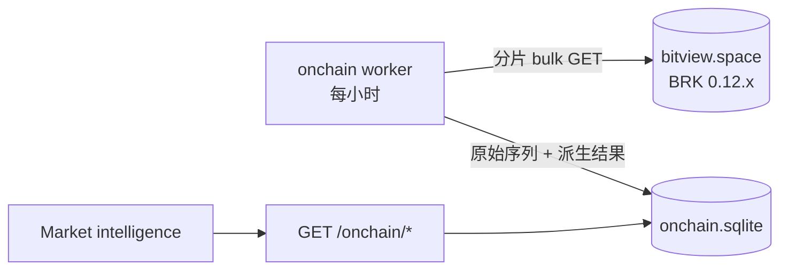

# BTC 链上与永续指标融合 Spec

日期：2026-10-16。状态：**草案 v3，待用户审阅**。界面已经用可视化伴侣逐屏确认；修订记录见 §10。审阅通过后，按阶段写实施计划（PLAN.md），然后开始实现。

**依据**
- [数据源核验](../../../research/alpha-dashboards-data-sources-2026-10-16.md)
- [计算逻辑与用法](../../../research/alpha-dashboards-logic-2026-10-16.md)
- [周期六态 classifier v2](../../../research/alphabtc-regime-cycle-source-2026-09-28.md)
- 本地证据：`.local/research-samples/alpha-dashboards-2026-10-16/`，已 gitignore。包括页面源码、逐页笔记、BRK 数据、复算脚本和 `/api/perps` 样本。
- 界面定稿 mockup：`.superpowers/brainstorm/33535-1792151482/content/`，共四屏：`layout-overview`、`key-levels`、`flows`、`mobile`。

**做法**
- 用户是原看板的作者，包括 alphabtc state-report，以及 alpha-vol 的 perp-squeeze、onchain-seller、onchain-pulse。
- 按用户要求分两步：
  1. **v1 先完全照原站口径重新实现**，界面也照原站做法。v1 不复制源码，但计算结果要与原站逐数对上。
  2. **v1 验收后，再按 §4 的优化清单逐项改进。**

## 0. 决定汇总

| # | 决定 | 结论 | 来源 |
|---|---|---|---|
| D1 | 页面结构 | 4 个方法 tab：TD Sequential / Key levels / Fibonacci / **Flows**；页头加周期徽章 | 第 1 屏选 A |
| D2 | 密集带画法 | 画在价格图右侧的刻度轨，成本线横贯整张图 | 第 2 屏选 B |
| D3 | Flows 布局 | 照原站多图纵排；"一张大图 + 详情"的约定只在 Flows tab 放宽 | 第 3 屏选 A |
| D4 | 窄屏说明文字 | 手机上也照原站，全部展开 | 第 4 屏选 B |
| D5 | 计算口径 | v1 = 原站口径；改进放进 §4 优化清单 | 用户："先按他那边来，做好后再自我优化" |
| D6 | 周期分类器 | 用 alpha-vol 页头版：整体门控，死区 7.0 / 6.8 / 1.25，从 2013 起算。这是本次融合的几页实际使用的版本。如果你要用 classifier v2，再告诉我 | 按 D5 推定 |
| D7 | 永续数据源 | 待你回复，见 §3.4 | — |

批准后同步更新 AGENTS.md 的「已确认的 UI」：加入 Flows tab，并写明 Flows 内允许多图纵排。

## 1. 目标与范围

**目标**：在 Market intelligence 里，对 BTCUSDT 提供四项能力：
- 周期状态；
- 链上成本价位；
- 链上卖压；
- 永续状态（P4，另立 spec）。

**成功标准**

| # | 标准 |
|---|---|
| 1 | v1 在同一份数据上，与原站页面数值一致：周期状态、成本线、密集带和价位表、卖压三张图的当前值与阈值。容差见 §6 |
| 2 | 只要读数里含未收盘的 bar 或日，界面就明确标出 forming。缺失和 QC 问题必须显示出来，不能当 0 静默处理（[金融领域规则](../../financial-domain.md)） |
| 3 | §4 的每一项优化都单独实现、单独测试、单独开启，开启前后的差异写进验收记录 |
| 4 | 在 1440px 和 390px 宽度下浏览器核验：无横向溢出，键盘能切换 tab，控制台无报错 |

**不做**
- state-report 的图 2、4、5、6、8。图 1A/1B（含三种口径）于 2026-10-19 按用户要求纳入，做法见 [PLAN-SELL-SIDE.md](PLAN-SELL-SIDE.md)。
- onchain-pulse 的 Exp1–6，以及人工解读。
- ETH 和 MU 的链上指标，因为 BRK 只覆盖比特币。
- 任何交易能力，以及链上 as-known 回放（理由见 §7）。

## 2. 架构

沿用 portfolio 子系统的模式：独立子包、独立 SQLite、独立 worker。
- worker 遵守 `create_app` 的 `start_worker` 参数。
- worker 负责取数，并预先算好派生结果。
- 读接口只读本地库，**处理请求时不访问 BRK，也不现算 KDE、GMM 或分位数**。

**后端**（`services/analytics/src/wheelhouse_service/onchain/`）

| 文件 | 职责 |
|---|---|
| `brk.py` | 按权重分片的 bulk 请求、逐条重试、URPD、`/version` |
| `store.py` + `migrations/` | 存储 |
| `sync.py` | worker |
| `cycle.py`、`pressure.py`、`levels.py` | 纯计算 |
| `models.py` | 契约 |
| `api.py` | 路由 |

**前端**（`overlay/.../wheelhouse/`）
- 新增：`onchain-client.ts`（Zod 校验）、`cycle-badge.tsx`、`onchain-levels.tsx`、`levels-rail.tsx`、`flows-panel.tsx`、`seller-charts.tsx`、`flow-read.tsx`（三栏说明）。
- 修改：`market-page.tsx`、`market-chart.tsx`、`i18n.ts`、`market.css`。
- 契约生成：Pydantic → OpenAPI → `make contract`。

## 3. 计算规则（v1 = 原站口径）

### 3.0 BRK 数据层（M0，基础设施，v1 和优化共用）

**要取的序列**

| 索引 | 序列 | 范围 |
|---|---|---|
| day1 | `price_close`、`true_market_mean`、`sth_realized_price`、`lth_realized_price`、`realized_price`、`utxos_1d_to_1w_old_realized_price` | 从 2013-01-01 起 |
| hour1 | `price_close`、`{sth,lth}_realized_{profit,loss}_cumulative`、`utxos_under_1h_old_realized_{profit,loss}_cumulative`、`sth_supply_in_{loss,profit}`、`utxos_under_1h_old_supply_in_{loss,profit}`，共 11 条；不取 `timestamp`，时间由位置推出（P2 实施时修订，见 PLAN-P2 裁定 P2-R1、P2-R6） | 最近 3,000 小时。v1 用其中最近 2,600 小时，与原站相同 |
| URPD | `all`、`sth`、`lth`，当天快照，`agg=lin500`；用户切换 Bucket 时再取 `lin200` 或 `lin1000` | 每小时刷新当天快照 |

**请求约束**（2026-10-16 实测）
- **单次权重上限 320,000**，约每点 16，所以一次最多约 2 万点。按每片不超过 18,000 点分片：day1 分 2 片，hour1 首次回填分 2 片（P2 实施时修订，见 PLAN-P2 裁定 P2-R1、P2-R6），增量刷新只取最后几个点。
- **bulk 是全有或全无**：只要有一个序列名不存在，整批都返回 `series_not_found`。这时把该片拆成逐条请求，找出缺失的序列，记为 `series_missing:<name>`。只有依赖这个序列的模块显示 unavailable。

**调度**：每小时 HH:12 UTC 刷新，刷新完重算全部派生结果。

**存储**

| 表 | 字段 |
|---|---|
| `series` | series, index, position, ts, value（可为 NULL）, fetched_at |
| `urpd` | cohort, date, agg, close, total_supply, buckets_json, fetched_at |
| `derived` | kind, as_of, payload_json, computed_at |
| `sync_state` | BRK 版本、各序列 `version`、最近成功时间、最近错误码 |

**版本变化**：先把新数据取到临时表，校验通过后原子替换。替换完成前继续用旧数据，`refreshing` 为真。

**新鲜度**：以最后一行的时间计算。hour1 在 2 小时内为 fresh，6 小时内为 delayed，超过 6 小时为 stale，从未取到为 unavailable。day1 的最后一行如果不是今天，就是 stale。

**失败处理**：保留旧数据，状态随时间自然降级，记录错误码，不补 0。日志只记路由、错误码和耗时。

**forming 标记**：BRK 不标注是否收盘，最后一行就是盘中值。v1 照原站使用这一行，但所有响应都要带上 `forming_at`（最后一行的时间），界面写明"includes the forming hour/day"。

### 3.1 周期六态（M1）

规则照 alpha-vol 页头。

**输入**：从 2013-01-01 起的 day1 序列 W（`utxos_1d_to_1w_old_realized_price`）、STH、TMM，**包含当天未收盘的值**。三条中任一条缺值的日期，整行删除。

**三个量**
- depth = 100·ln(W/TMM)
- spread = 100·ln(STH/TMM)
- pvs = depth − spread

**状态映射**：值大于 0 记为正，其余记为负。三个符号对应六种状态：

| 状态 | 成本线排序 |
|---|---|
| Advance | W > STH > TMM |
| Breakout | W > TMM > STH |
| Pressure | STH > W > TMM |
| Repair | TMM > W > STH |
| Breakdown | STH > TMM > W |
| Capitulation | TMM > STH > W |

**滞回（整体门控）**
- 第一行直接取原始状态。
- 此后，若原始状态与当前状态不同，只有当每个发生翻转的分量都满足 |值| > 死区时才切换；否则不动，也不记住部分翻转。
- 死区：depth 7.0、pvs 6.8、spread 1.25。

**天数**：本段的行数，含今天。

**QC**：最后一行距今超过 3 天时，提示数据过期。

**输出**
- 当前状态、开始日期、第 N 天；
- 三个量、死区、是否支持当前状态；
- 全部历史段，以及切换总次数。

### 3.2 成本价位（M2，照 state-report 图 7 和表 2）

**模型线**：5 条，取 day1 最后一行（含当天）。

| 名称 | 来源 |
|---|---|
| True mean | `true_market_mean` |
| Short-term | `sth_realized_price` |
| Average | `realized_price` |
| Long-term | `lth_realized_price` |
| Median | 由 `all` lin500 URPD 计算：累计供应达到总供应一半的位置，在桶内线性插值；包含低于 $1,000 的币 |

**密集带（K）**
- STH、LTH 分开计算，输入为当天 lin500 URPD。
- 价格域：floor ≥ $1,000 的全部桶，相当于原站 RANGE=All 的默认视图。
- 算法：
  1. 以供应量为权重做高斯 KDE，带宽 = 0.02 × 价格域跨度。
  2. 取局部极大，保留 prominence ≥ 0.05 × 最高峰的峰，峰数不设上限。
  3. 每个峰输出：center；WIDTH = 半高全宽（FWHM）；BTC = center ± FWHM/2 内的权重和；SHARE = BTC ÷ 该侧总权重；STRENGTH = prominence ÷ 最高峰。

**高斯成分（M）**
- 用加权一维 GMM，按 EM 拟合：用分位点初始化，最多迭代 120 次。
- 成分数 k = KDE 峰数，上限 min(5, 桶数/5)。
- 每个成分输出 μ、σ、share。
- 原站在 Smoothing=Off 时会改用 BIC 选 k，实测恒选 1。v1 没有 Smoothing 控件，所以不涉及这条路径。

**附近的有筹码价带**（原站图 7 旁的表）
- 把价格域切成每段 $2,000。
- 候选价位：5 条模型线，以及 STH、LTH 每个 M 成分的 μ−σ、μ、μ+σ。段内有任一候选，就算"有筹码"。
- 现价取 URPD 的 `close`，即原站所用的链上价格。排除现价所在的段，上下各取最近 4 段。
- 每段列出：方向、价格区间、包含的候选数、候选标签、距现价的百分比。

**价位表**（原站表 2）
- 第 i 列：阻力 = 上方第 i 个有筹码段的上沿；支撑 = 下方第 i 个的下沿。
- 列名用 1st / 2nd / 3rd / 4th，不沿用原站带时间含义的 "1-Week…4-Week"（原站文案问题，不影响数值）。

**Bucket 切换**：$200 / $500 / $1000 分别用 lin200 / lin500 / lin1000。**默认选中并实际绘制的都是 $500**；原站这里默认高亮 $1000、实际却画 $500，属于界面缺陷，不照搬。

### 3.3 卖压（M3，照 onchain-seller）

**取数**：最近 2,600 个 hour1 行，**包含最后一行（未收盘）**。

**行过滤**：只有当价格和 4 条累计值（sth、lth 的 profit 和 loss）的当前值与前值都不为空时，才保留该行。
- 没有出块的小时，BRK 会把这些值都返回为 null。照原站，这一行会被删除，并且会连带删除下一行。

**每条腿**：max(0, C[i] − C[i−1])，按 $100 取整后存储。

**STH 剔除持有 <1h 的币**：固定开启。
- STH_loss_x1 = max(0, ΔSTH_loss − Δ<1h_loss)，用未取整的原值相减。
- 该小时的 <1h 数据缺失时不剔除，并累计到 `xgap` 计数。

**三张图**（全部 1 小时一根，不平滑）

| 图 | 内容 |
|---|---|
| 图 1 | LTH_loss 与 STH_loss_x1 堆叠 |
| 图 2 | STH_loss_x1 ÷ (LTH_profit + LTH_loss + STH_profit_x1 + STH_loss_x1)；分母 ≤ 0 时该行跳过 |
| 图 3 | (STH_in_loss − <1h_in_loss) ÷ (同口径的 in_loss + in_profit)；只取图 1 保留下来的小时 |

**阈值**
- 窗口：t > t_last − 720h，包含最后一行。
- 分位数用 R-7 线性插值。P75 为 Warning，P95 为 Extreme。
- 每次刷新只算一组，画成横贯整个可见区间的虚线。

**Span**：每张图独立选择，7d / 30d / 90d 分别取最后 168 / 720 / 2,160 行。Span 不影响阈值。

**综合信号**：没有，这与原站一致。

### 3.4 永续状态（M4，P4 另立 spec）

**v1 照原站 2026-10-01 版**
- block：4h 或 8h，按 UTC epoch 对齐；末尾不足半块的部分丢弃。
- dPx = (末桶价格 ÷ 首桶价格 − 1) × 100；dOI 为块内首尾之差；delta 和清算在块内求和。
- 参考窗口：已取到的全部块，包括当前块。
- 分位数：取排序后第 floor(q·(n−1)) 个值。
- 判定：8 种状态，按顺序取第一个命中的，见计算逻辑文档 §2.2。
- Hyperliquid 的清算：按 OI 占比估算。界面标注 "estimated"，原站这里的标注不完整。
- 缺失值：照原站在块内求和时按 0 计。但原站的 QC 规则要显示出来：网格步长 600 秒、最大空洞不超过 1,800 秒、每条序列缺失不超过 1%。原站嵌入其他页面时会隐藏 QC 提示，我们不隐藏。

**对照基线**：已存 `/api/perps` 样本，时间 2026-10-16 10:49Z，sha256 前缀 `2e65bb44`。同一时刻的页面读数（4h、All venues、30d，共 180 块）：

| 状态 | 块数 |
|---|---|
| Long squeeze | 14 |
| Short squeeze | 8 |
| Long unwind | 3 |
| Short unwind | 8 |
| New long | 5 |
| New short | 6 |
| Spot-led | 21 |

**数据源（D7）**

| 方案 | 内容 | 缺什么 |
|---|---|---|
| A. Glassnode | 你提供 key 或 DataX 网关 | 不缺；可以与原站逐块对照 |
| B. 免费 + Coinalyze | OI：Binance 日包和 Bybit；delta：Binance K 线；清算：Coinalyze 4h（需要你注册拿 key） | Hyperliquid；"All venues" 只是 Binance 与 Bybit 之和 |
| C. 完全免费 | 同 B，但清算靠自建 WebSocket 采集 | 同 B，另外清算图和 squeeze 状态要等采集满 90 天 |

## 4. 优化清单（v1 验收后逐项启用）

每一项都要做到四件事：单独实现、单独加测试、界面写明口径、验收记录写清启用前后的差异。

| # | 模块 | 优化内容 | 理由 |
|---|---|---|---|
| O1 | 全部 | 只用已收盘的小时、日、块；未收盘的那一行只画出来，不进入阈值、状态和价位 | 避免读数随盘中波动；金融规则要求写明已收盘与形成中 bar 的处理策略 |
| O2 | 卖压 | 阈值改为逐小时滚动，只用该小时之前 720 个已收盘小时；新增 `level` 与 `run` 读数 | 原站用"今天"的阈值套整个历史，有前视，历史柱也不可读 |
| O3 | 卖压 | 没有出块的小时沿用累计值、流量记 0，不再连带删除下一行；只有部分序列缺失时记 null 并打 `gap` | 原站会丢掉真实的流量 |
| O4 | 周期 | 缺失日沿用上一状态；按日历计天 | 计天不受缺行影响 |
| O5 | 价位 | KDE 价格域改为 URPD 收盘价 ±50%，不再随可见范围变化；评估 GMM 的价值（修 BIC 或去掉）；加入 1d–1w 线 | 结果稳定、可复现 |
| O6 | 永续 | 参考窗口只用过去 90 天；分位数改用 R-7；dPx 以上一块收盘为基准；squeeze 要求清算 > 0；缺失记为 unavailable；不再估算 Hyperliquid 的清算 | 去掉前视，缺失不当 0 |

**v1 直接修正、不复制的原站界面缺陷**（不影响数值）
- Bucket 默认高亮与实际绘制的数据不一致（§3.2）。
- 价位表列名带时间含义（§3.2）。
- 嵌入时隐藏 QC 提示（§3.4）。
- STH 文案写成 155 天：界面改为 "STH (<150d)"，与 BRK 一致。

## 5. 界面（已用可视化伴侣逐屏确认）

**页头（只对 BTCUSDT）**
- 徽章显示 "Cycle · Breakout · day 24"，附 "since 23 Sep · includes today (forming)"。前缀 "Cycle" 是为了和 DeMark 的 "Breakout decay" 区分开。
- stale 或 unavailable 时徽章变灰，并写明原因。点击后跳到 Key levels 的 Cycle 区块。

**方法 tab**：TD Sequential / Key levels / Fibonacci / **Flows**，支持方向键、Home、End 切换，当前选中写入 URL。

**Key levels（BTC）**
- **价格图**：
  - 5 条模型线横贯整张图。
  - 右侧留约 28px 的刻度轨，画 STH 和 LTH 的 K 密集带：颜色区分两个 cohort，宽度表示 STRENGTH。悬停某条带时，在图上把它淡淡铺开。
  - 有三个开关：Cost lines / STH bands / LTH bands。
  - 超出当前价格范围的线，在图的上沿或下沿贴边标注（箭头加价格），不扩大 y 轴。
  - 只在实时视图叠加；查看已保存快照或历史 cutoff 时隐藏，并提示原因。
- **Inspector**（从上到下）：
  1. 价位表：阻力和支撑各 4 个，列名为 1st–4th；
  2. 附近有筹码价带列表；
  3. Cycle 区块：状态、开始日期、天数、三个量与死区、是否支持当前状态；
  4. Source：Bitcoin Research Kit · bitview.space、BRK 版本、数据时间，并注明价格是链上 oracle 估价、STH 是 <150 天。
- 原有的 baseline 指标保留。
- **ETH / MU**：只显示原有内容，另加一行 "On-chain levels are BTC only"。

**Flows（BTC）**
- 子视图切换：Seller pressure | Perp states，写入 URL 参数 `flow`。这个 tab 里不显示时间周期控件。
- **Seller pressure**：照原站三张图纵向排列。每张图有：
  - 标题；
  - 自己的 Span 选择（7d / 30d / 90d）；
  - Extreme 和 Warning 的数值；
  - 图例和当前值，如 LTH loss、STH loss、BTC/USD；
  - 下方三栏说明：What it shows / What extreme values imply / How to read。

  页头一行写 "Resolution 1h · Data <时间> UTC · Source Bitcoin Research Kit"。未收盘的那一根柱用虚线框标出。
- **Perp states**：
  - P4 之前：显示 "Not connected" 横幅，写明缺哪个数据源。不放示例数据。
  - P4 之后：照原站排列 Parameters（Exchange / State window / Show）、Table 1（State / What it is / Prob. / Max move）和图 1–4，每张图都配三栏说明。
- **ETH / MU**：可以进入这个 tab，内容是 "Flows are BTC only"。

**窄屏（≤ 600px，以 390px 核验）**
- 4 个 tab 平铺在一行，字号 10px，沿用现有样式。
- 页头徽章单独换一行。
- Key levels：inspector 移到图下方；刻度轨缩到 16px；Cycle 和 Source 两个区块默认折叠。
- Flows：三栏说明**照原站全部展开**，改为上下排列。
- Perp states 的 Table 1：只保留 State、Prob.、Max move 三列，What it is 可以展开查看。

**通用**
- 文案走 `i18n.ts`，en 和 zh 的键保持一致。
- 沿用现有暗色风格：Orbitron、Inter，金融数值用 JetBrains Mono。
- 键盘焦点可见。

## 6. 验证

**Fixture**：BRK 公开数据，整理后提交。
- 已有：`.local` 样本中 2026-10-16 抓取的 day1 四条、hour1 十二条，以及当天的 lin500、lin1000 URPD。
- 实施时补抓：day1 的 `lth_realized_price` 和 `realized_price`、`all` 的 lin500 URPD。补抓时比对每条序列的 `version` 字段；若 BRK 中途重算过，记录差异并重新确认期望值。
- `/api/perps` 样本只留在本地，到 P4 再决定。

**v1 与原站对照**
- 期望值取子代理在同一份数据上的全精度复算结果，相对容差 1e-9。页面显示值作为人工核对（复算值都落在页面的舍入范围内）。
- 卖压的阈值依赖"最后一行"，所以对照时把数据截到页面当时的最后一行，即 2026-10-16 08:00。

| 项目 | 期望 |
|---|---|
| 周期（截至 2026-10-16） | Breakout，自 2026-09-23 起，第 24 天；全史 48 次切换 |
| 卖压当前值 | LTH loss $1.983M，STH loss $8.540M，share 41.89%，supply in loss 29.57% |
| 卖压阈值 P95 / P75 | $41.346M / $10.050M；56.12% / 22.15%；38.69% / 26.15% |
| 成本价位 | 模型线与 BRK 当时的值一致：STH $74,462、True mean $77,476、Average $53,842、Long-term $49,242、Median $63,721；STH 3.67M BTC，68% 在盈利；LTH 12.78M BTC，59% 在盈利；价位表与当时页面一致：阻力 86.0k / 88.0k / 96.0k / 104.0k，支撑 80.0k / 76.0k / 74.0k / 70.0k |

当天的 URPD 快照在日内持续变化，08:20 页面时刻的那一份事后无法复原，所以成本价位这一行只作参考。实施 P3 时，要在已登录的浏览器里**同时抓取**原站 state-report 的页面读数和同一时刻的 BRK 数据（`all`、`sth`、`lth` 的 URPD 和 day1 最后一行），把这一对数据存为价位对照的黄金样本，价位表要逐格一致。周期和卖压不受影响：它们所依赖的数据已在样本中。

**单元测试与数据层测试**
- 周期：整体门控在边界上（恰好等于死区时不切换）、缺失日删除、天数口径。
- 卖压：行过滤（包括连带删除下一行）、x1 剔除、分母 ≤ 0。
- 价位：KDE、GMM 的确定性（快照测试）；$2,000 分段的边界；Median 插值。
- 数据层：
  - 权重分片：每片不超过 18,000 点；
  - `series_not_found` 时拆成逐条请求，只影响依赖缺失序列的模块；
  - 版本变化后的原子替换；
  - BRK 不可达时保留旧数据；
  - 读接口不访问外网：注入一个会直接失败的 HTTP 客户端，读接口照常返回；
  - `start_worker=False` 时 worker 不启动。

**前端测试**
- Zod 契约、i18n 键一致。
- 各种状态的渲染：unavailable、stale、refreshing、forming、BTC only、Not connected、QC 警告。
- 贴边标注；快照视图下隐藏叠加；刻度轨悬停铺开。
- 窄屏下三栏说明全部展开。

**浏览器核验**：1440px 和 390px 两种宽度下，逐一检查页头、Key levels 和 Flows，与四屏 mockup 对照。

**优化项**：每项开启前先确认 v1 的对照测试仍然通过；开启后新增该项自己的测试，并记录数值差异。

## 7. 分阶段交付

| 阶段 | 内容 | 依赖 | 验收 |
|---|---|---|---|
| P1 | M0 数据层；M1 周期；5 条模型线；页头徽章；Key levels 的模型线、贴边标注和 Cycle 区块；Flows tab 外壳（两个子视图都显示占位） | 无 | 周期和模型线对照通过；浏览器核验通过 |
| P2 | M3 卖压三张图和三栏说明 | P1 | 卖压对照通过 |
| P3 | M2 的 K/M、刻度轨、附近有筹码价带、价位表 | P1 | 价位表逐格一致；快照测试通过 |
| P4 | 永续状态（另立 spec） | D7 的答复 | 写在 P4 的 spec 里 |
| P5 | §4 优化清单，逐项进行 | P1–P3 验收；O6 依赖 P4 | 见 §6 |

- 每个阶段单独写计划、单独实现、单独验收。
- 发布到 Coolify test 按 [发布流程](../../deployment/RELEASING.md) 另行进行。
- **不做 as-known 回放的原因**：链上数据的历史修订极少，主要来自区块重组；要支持回放就得建修订表，成本高、收益低。本期只记录 `fetched_at`。

## 8. 风险与前置条件

- **BRK 公共实例**：没有 SLA，没有数据条款，单次请求有权重上限，bulk 全有或全无，升级时可能重命名序列。
  - 已有的缓解：分片、逐条定位缺失序列、版本检测、失败时保留旧数据。
  - 长期办法：自建 bitviewd（需要非裁剪全节点、约 290 GiB、16 GB 内存），或使用你已有的实例。
- **v1 含未收盘值**：读数在一小时或一天之内会变化。界面统一标注 forming；O1 启用后不再有这个问题。
- **工作区**：当前在 main 分支，有大量未提交的改动，其中包括本 spec 要修改的 `market-page.tsx`、`market-chart.tsx`、`i18n.ts`、`market.css`。实施前需要你决定：先整理并提交，还是从当前状态开分支或 worktree。
- **价格口径**：BRK 的价格是链上 oracle 估价，与 Bybit 现价有 basis 差异。价位表的"距现价"照原站用链上价格，并在界面上写明。
- **`.superpowers/`**：这个目录目前没有写进 `.gitignore`，mockup 文件可能被误提交。建议你把它加进 `.gitignore`。

## 9. 待你提供

| # | 内容 | 影响 |
|---|---|---|
| 1 | 永续数据源：Glassnode key 或 DataX 网关（写进本机 `.env`，不要贴到聊天里）；或者注册 Coinalyze 拿 key；或者回复"完全免费" | P4 |
| 2 | 可选：确认周期分类器用 alpha-vol 页头版（D6） | P1 |
| 3 | 可选：`/api/perps` 的服务端代码和 `gn_fetch.py` | P4 的对照 |
| 4 | 可选：作者文档原文（playbook §7/§11/§16、qfilabs 中死区的推导、note No. 8、template 08） | 核对参数意图 |
| 5 | 可选：你自建的 BRK 或 bitviewd 实例 | 数据源稳定性 |

## 10. 修订记录

**v3 实施修订**（P2 实施时，见 PLAN-P2 裁定 P2-R1、P2-R6）
- §3.0 hour1 不取 `timestamp`，共 11 条序列；hour1 首次回填按实际计算为 2 片，不是 3 片。

**v2 → v3**（用户逐屏确认界面，并要求"先按原站来，做好后再自我优化"）
- 计算基线改为原站口径（§3）。v2 中与原站不同的做法（已收盘口径、滚动阈值、无出块沿用、KDE 价格域、只用 KDE、永续保护等）整体移入 §4 优化清单 O1–O6。
- 成本价位改为照原站：模型线包括 Median，不含 1d–1w；同时做 KDE 和 GMM；价位表和附近有筹码价带用 $2,000 分段规则。
- 界面定稿（§5）：4 个 tab 加 Flows；密集带画在右侧刻度轨；Flows 照原站多图纵排，并放宽"一张大图"的约定；手机上三栏说明全部展开。
- 周期分类器按原站用 alpha-vol 页头版（D6）。

**v1 → v2**（独立评审：2 条严重、6 条中等、2 条低等，均已修订）
- BRK 权重上限、bulk 全有或全无（已实测）→ 改为分片请求、逐条定位缺失序列。
- 价位线会拉宽 y 轴；历史视图叠加会造成前视 → 改为贴边标注，只在实时视图叠加。
- 收盘判据和 as-of 口径、KDE 价格域、卖压的边界情况、fixture 的容差、P4 规则冲突、周期偏离、AGENTS.md 同步、徽章命名、版本替换顺序、`start_worker`、预计算、窄屏规则 → 均已在 v2 中补齐。v3 把其中涉及口径的部分转入 §4。
